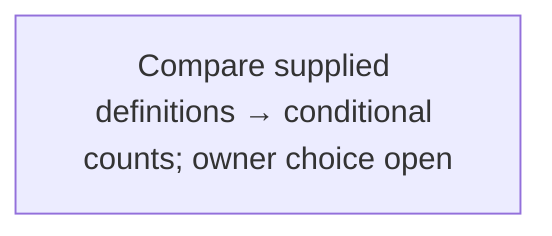
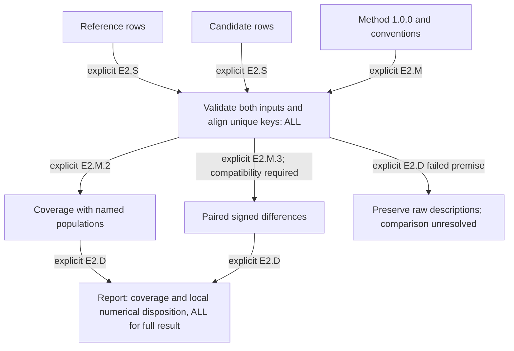

# Direct prompt authoring — documentary candidate v0.1.0

## Status, sources and minimum design

**Proposed contract; inactive.** This single document contains the proposed
rules, an authoring aid, complete inert examples, reusable procedure contents,
record placement and exact migration proposals. It neither changes current
policy nor authorizes its examples. Current CPC remains the dispatch contract.
No compiler retirement, qualification, adoption, integration or publication is
claimed. An owner decision on the returned evidence remains separate.

Design basis: TOP26006_fw master
`5ba30bcc367d39e3131335a0eb55fdbc5bc54ce4`, acquired from local Git objects.
The execution report preserves the consumed source bytes and blob identities.
Relevant sources are [CPC](../../CPC.md), [AGENTS](../../AGENTS.md),
[repository registry](../../governance/repositories.md),
[Git lifecycle](../../governance/contracts/git_lifecycle.md),
[orchestration](../../governance/contracts/orchestration.md),
[evidence](../../governance/contracts/review_and_evidence.md),
[autonomy](../../governance/contracts/autonomy_and_blocker_classification.md),
[model policy](../../governance/model_policy.md),
[prompt reference](../reference/prompt_contract.md),
[report reference](../reference/report_contract.md),
[manual authoring](../how_to/write_a_prompt_manually.md),
[continuation](../how_to/prepare_a_continuation.md), and the four local skill
contracts under `.agents/skills/`. The applicable repository module is root;
there is no nested AGENTS under the new document's path at this base.

The fixed design direction is direct consumption by the agent, flexible
semantic blocks, optional reusable methods, attempt records in existing
reports, a mandatory derived documentary graph, and explicit reproducibility.
The minimum design here adds no component system, parser, registry, database,
runner or installed skill. The maintained classic CPC manual path is the
comparison baseline. No compiler rejection, impossibility proof, fresh
architecture evaluation or performance benchmark is asserted.

A two-field nucleus (`prompt_id`, `decision_question`) is useful for indexing
an idea. It is insufficient for an actionable task: it cannot distinguish a
read from a write, bind a scientific convention or select an immutable attempt
profile. This candidate retains eleven universal named author inputs, with
conditional contracts selected by actual activity and effects. Reducing
labels alone is not the benefit claimed.

## P — proposed prompt construction contract

### P1. One mandate and flexible semantic blocks

Deliver one versioned `CODEX_PROMPT*.md`, consumed directly by the executor.
The blocks may be prose, tables or fenced mappings. Their order is flexible;
logical bindings must be unambiguous. Use canonical field names for actual
interfaces. Each value has one authoritative definition; a scoped stage key
is a distinct definition for that stage, never an alias or inherited grant.
The prompt must let its consumer locate goal, inputs, effects, result and
continuation without recovering another task mandate from a chat or companion
plan. External governance, configuration, data, prior reports and a resolved
stable method are permissible inputs with explicit roles and preserved contents.
A referenced method supplies procedure, never a missing task decision.

The universal named inputs are:

1. `prompt_id`: stable task identity, not a result or acceptance claim.
2. `task_revision`: explicit revision of the exact instruction content.
3. `decision_question`: one substantive decision and its owner boundary.
4. `prompt_mode`: one existing mode, constraining rather than granting effects.
5. `preferred_codex_model`.
6. `reasoning_level`.
7. `delegation_policy`.
8. `model_selection_rationale`: retain the actual author selection and reason.
9. `allowed_to_modify`: exact typed repository, paths/resources and effects
   that bound any grant; an empty map means no writable surface.
10. `read_only`: protected resources and real input scope, without contradictory
    overlap with an exact writable descendant.
11. `validation_ceiling`: maximum validation; actual work can be narrower.

Required semantic content also includes the mandate/authority provenance,
actual inputs and conventions, observable result, relevant failure behavior
and acceptance boundary. These are obligations, not optional because they are
outside the eleven-field count. Scientific choices and exact targets must
remain explicit. There is no rule that eleven labels suffice for every task.

### P2. Defaults, consumers and conditional precision

| Content | Author responsibility | Executor/consumer responsibility and proposed default |
| --- | --- | --- |
| Governance | Bind TOP26006_fw and the selected repository role; explicit owner overrides identify rule and scope | Acquire current master and the union of applicable router contracts before dependent actions; candidate policy cannot validate itself |
| Installation | Name selected repository IDs and the exact profile input; explicit paths if no usable profile or a physical target is material | Resolve existing YAML profile and verify root/repository identity before effects; record resolved `workspace_root` and `repo_locations` in the attempt workbook |
| Targets | Explicit repository-relative source/output paths; explicit absolute external resource/worktree paths and refs when relevant | A profile cannot select science, activate an inactive repository or choose a new target; ambiguity stops its consumer |
| Capabilities | Explicit exact positive grant map plus scope/action, with required denials | Omitted capabilities denied; mode, graph, method and profile confer none |
| Branch | Applicable outer `branch_policy`, or each branch-relevant `stage_branch_policy`, and exact lifecycle/commit fields | Current Git contract unchanged; acquire volatile facts where consumed, preserve foreign work |
| Preflight | Declare alternatives and non-derivable minimum scope | Existing `compact_preflight` and `require_clean_worktree`; these defaults are unchanged |
| Result | Task-specific result content and any delivery exception | Standard existing report fields, one actual patch, derived evidence path/collision rule and final result/evidence/limits/next-boundary response |
| Patch | State an exceptional comparison surface if needed | Derive `patch_kind_expected` from authorized delta: `prompt_local` for task-owned mutation; `empty_no_changes` for no tracked change; explicit cumulative alternatives when requested. Record actual kind and creation method |
| Short title | Supply only if a real consumer needs a distinct title | Optional display title derived from question; it never selects a target or authority |
| Language/format | State a nonstandard language, format, recipient or handoff when material | Standard result content above; no universal duplicate `final_chat_deliverable` paragraph |
| Method | Select a compatible method revision and bind its inputs/conventions, or use none | Resolve actual content before use; unresolved method blocks that method's claim, not unrelated evidence |
| Review | Required depth from actual risk and contract | Same independent-review default and omission rule; no universal second model or new approval gate |

The root/repository locations are **relocated observed facts**, not guessed
paths. Name an explicit physical path in the prompt whenever relocating it
would leave target ownership or identity ambiguous. The profile is data, not
an instructional companion. Its pre-existing maintenance burden counts in the
benefit test. Installation values must be serialized before an effect consumes
them, not retroactively asserted as verified.

For non-orchestrated work, `heavy_command_permissions` remains the sole
positive capability map. Outer `allowed_to_modify` bounds it. For
`orchestrated_workflow`, outer `branch_policy` and `heavy_command_permissions`
remain prohibited; `workflow_effect_envelope` only caps and each
`stage_effect_permissions` alone grants stage effects. Exact action/path/ref
contracts remain additional requirements. Never pool grants or infer a retry.
All existing permission names and separate network, query, submit, storage,
delete, publication, merge and unblind boundaries survive.

Apply orchestration rules to ordered cross-mode/effect dependencies,
delegation, independent review and long-horizon work **across all modes**.
Use stage serialization only where the orchestration contract requires it.
Ordinary editing, checking and commit inside one coding contract stay ordinary.
Long-horizon fields remain `durable_objective`, `definition_of_done`,
`hard_boundaries`, `checkpoint_ledger`, `validation_loop`, `resume_semantics`,
and relevant resource/time ceilings. A different substantive decision stops.
A graph loop cannot create a repair edge, effect, iteration budget or permission.

Continuations retain `continuation_of`, and real-state
`accepted_prior_evidence`, `accepted_closure_layers`, `invalidation_boundary`,
`delta_scope`, `unresolved_checks_only`, `checks_not_to_repeat`. Acceptance
provenance and claim boundary must be explicit; scenario premises are not
historical owner acceptance. Evidence/audit work retains
`evidence_requirements`, `classification_rules`, `anti_self_certification_rules`,
`evidence_validation_method`. Model-profile proof fields remain conditional
on actual decision materiality; unobservable runtime identity is reported
honestly. An observed profile mismatch/switch stops the attempt. Git commit,
publication, production and recovery retain their current conditional fields.

### P3. Mandatory derived non-authoritative graph

Every prompt has a planned graph, including an atomic one-node view. Derive it
from source meaning after drafting the mandate. Nodes denote inputs, actions,
results or decisions. Distinguish data, prerequisite and alternative routes.
Each decisive relation has a source locator in the prompt/method/evidence;
use stable section/node labels, not a drawing's geometry, as locators.

Label relations `explicit`, `inferred` or `unresolved`. An inference states
its basis and must not silently choose an owner/scientific decision. Unresolved
relations remain visible and stop only what requires resolving them. List
order does not establish dependency; absent arrows do not establish independence.
An all-input join requires every named input; an alternative join states the
permitted alternatives. A failure/partial route names what remains valid.

Cycles may describe real iteration. Record attempt/stage instances and the
actual authorized repair boundary; never force the history into a DAG or
turn a cycle into automatic retry. Correct a graph contradicted by clear
source text. When the source itself is ambiguous, expose the missing decision
rather than making a prettier drawing. A graph defect does not annul an
independent supported result. A material source ambiguity still gates its
consumer. A one-node graph may annotate its input/result relations in prose.

The observed graph is a separate view recorded in the existing report, with
actual completed, failed, unknown and unstarted nodes and evidence locators.
It may be a status annotation of the planned view plus changed relations;
it must not mark a planned action as executed. Neither view grants effects.

### P4. Reproducibility and attempt workbook

Use the existing `<evidence_root>/<prompt_id>/` collision mechanism and
`<prompt_id>_report.md`, actual patch and conditional stage/checkpoint ledgers.
The report is the workbook: a case/attempt record, not a new skill, registry or
database. A playbook is stable procedure; an optional skill packages a qualified
maintained procedure/tool. These are different roles, not three copies of the
same record. Do not create a skill for an atomic task.

Preserve the exact prompt revision and consumed input/method/configuration
contents: a reachable Git object with a locator and retention basis, or actual
bounded bytes in the evidence package, plus source identity and validity scope.
A hash, filename or mutable URL alone does not preserve contents. Record method
parameters and conventions separately from method release identity. A modified
denominator is a different test configuration, even under the same method ID.
Unresolved or unavailable contents prevent the dependent reproducibility claim.

Record requested, selected and runtime-reported model/reasoning distinctly,
unobservable values as `not_observable`, delegation, effective tooling,
commands/outputs/evidence, decisions and observed graph. One attempt has one
immutable configuration. A changed task, method convention or model selection
gets an explicit revision/new attempt under its actual authorization; a new
attempt is never inferred from silence. Preserve valid earlier evidence within
its invalidation boundary. Read back ambiguous effects before any authorized
recovery. Report task/evidence acceptance separately from scientific acceptance.

For a model comparison, keep task revision, actual inputs, method content and
parameters, permissions, validation and acceptance criteria fixed. Record
uncontrolled context: tool/service state, ordering, caches, concurrent changes
and stochastic variation. A factor that differs creates a different
configuration; it cannot be normalized away in prose. No identical stochastic
output, benchmark, time, token, cost or quality advantage is promised here.

## A — authoring aid

This is a lightweight fillable aid, deliberately not a second normative
catalog. The complete examples below show finished cases. Square-bracketed
slots in this aid require replacement and are not dispatch-ready.

```text
prompt_id: [stable task identity]
task_revision: [explicit revision]
decision_question: [one decision, including owner boundary]
prompt_mode: [existing mode]
preferred_codex_model: [author-selected concrete model]
reasoning_level: [author-selected effort]
delegation_policy: [forbidden, allowed or required]
model_selection_rationale: [specific reason]
allowed_to_modify: [exact repository, paths and effects or empty map]
read_only: [exact inputs and protected resources]
validation_ceiling: [existing ceiling]
```

Then state, once each: mandate; selected repository/profile or explicit paths;
input contents and conventions; actual result; applicable branch/grant and
conditional contract fields; partial/stop behavior; acceptance boundary. Add a
method only when useful. Derive graph and title. Standard reporting and omitted
capability defaults come from P2, not an unspoken second mandate. Before a real
dispatch, acquire current rules, resolve all real decisions and check the full
prompt. This proposed aid is not an exception to current CPC.

## E1 — complete inert atomic example: cell counting

Everything between the E1 markers is one candidate-only example prompt. It is
not a current-CPC dispatch and creates no authority for filesystem writes.

<!-- example_e1_start -->
# Compare two supplied meanings of cell

```yaml
prompt_id: example_cell_count
task_revision: '1'
decision_question: What counting consequences follow from each supplied cell definition, leaving the scientific choice to the owner?
prompt_mode: investigation_only
preferred_codex_model: gpt-6-luna
reasoning_level: medium
delegation_policy: forbidden
model_selection_rationale: Bounded comparison of supplied text with no choice of scientific definition.
allowed_to_modify:
  TOP26006_fw:
    diagnostics: /users/apiccine/work/correction-lib/reports/diagnostics/example_cell_count
read_only:
  - supplied_definitions_only
  - all_tracked_files_indexes_refs_and_external_resources
validation_ceiling: static_inspection_only
execution_not_authorized: true
branch_policy: read_only_current_branch
heavy_command_permissions:
  allowed_to_modify:
    TOP26006_fw:
      diagnostics: /users/apiccine/work/correction-lib/reports/diagnostics/example_cell_count
  network_access: false
```

**E1.S authority/input.** Inert supplied scenario, no owner execution grant.
Repository context is TOP26006_fw; installation input is
`/users/apiccine/work/correction-lib/.top26006/local_profile.yml`. No scientific input files
or application code are read. A hypothetical authorized attempt may read the
bound profile and current governance for preflight. Supplied definitions are A: “cell =
process/coefficient pair in one era”; B: “cell = bin/process/coefficient tuple
in one era”. The owner alone selects the scientific meaning.

**E1.R result/procedure.** Explain both meanings from supplied text. In a fixed
era, let S be the set of present process/coefficient pairs. A counts |S|.
Let T be the set of present bin/process/coefficient tuples. B counts |T|.
For a pair p, let B_p be its present bins; B counts the sum of |B_p| over
present pairs. If all P processes, C coefficients and B bins form complete
Cartesian populations, the counts are P*C and B*P*C. Do not assume completeness,
a shared bin population, or decide which definition applies to real analysis.
The counts agree when each present pair has exactly one present bin. With
multiple eras, sum the separately defined populations by era; do not erase era
identity or infer cross-era matching. This is conditional counting, not a
measurement. No method/skill is needed for this atomic task.

**E1.D delivery/stops.** Hypothetical result uses the existing report core and
actual empty tracked patch under the exact diagnostics scope, resolving a
collision by the existing observed rerun rule; final answer explains counts
and the unresolved scientific choice. Stop the affected conclusion if supplied
terms are ambiguous. Do not change tracked files, indexes, science, refs or external services.
A report or executor completion cannot select/accept the scientific definition.
During this documentary round the example is not executed, including diagnostics.

**E1.G planned graph.** One task node; its input and result relations are
explicit from E1.S and E1.R. There is no inferred external dependency, alternative
join or iteration. The unresolved owner definition is an output boundary, not
a prerequisite to explaining both alternatives.



**E1.O observed view.** Scenario only: the node is planned, no execution or
acceptance evidence. A future authorized attempt records its own observed view.
<!-- example_e1_end -->

## E2 — complete inert reuse example and method contents

The method below is an inline reusable playbook, not an installed skill. A
consumer may reuse its exact content rather than redesign it. This example
includes the full procedure so that it has no hidden instructional dependency.
A future maintained content reference is allowed only under P4; embedding or
preserving the method is counted as work, not credited as eliminated content.

<!-- example_e2_start -->
# Compare supplied synthetic weighted yields using a reusable procedure

```yaml
prompt_id: example_weighted_yields
task_revision: '1'
decision_question: What key coverage and signed-reference differences follow from the supplied compatible synthetic yields?
prompt_mode: investigation_only
preferred_codex_model: gpt-6-luna
reasoning_level: high
delegation_policy: allowed
model_selection_rationale: Bounded key alignment and numerical-convention review with adversarial missing and signed-zero cases.
allowed_to_modify:
  TOP26006_fw:
    diagnostics: /users/apiccine/work/correction-lib/reports/diagnostics/example_weighted_yields
read_only:
  - supplied_synthetic_yields_and_method
  - all_tracked_files_indexes_refs_and_external_resources
validation_ceiling: static_inspection_only
execution_not_authorized: true
branch_policy: read_only_current_branch
heavy_command_permissions:
  allowed_to_modify:
    TOP26006_fw:
      diagnostics: /users/apiccine/work/correction-lib/reports/diagnostics/example_weighted_yields
  network_access: false
```

**E2.S authority/input.** Supplied inert scenario; no real execution grant.
Repository TOP26006_fw; installation input
`/users/apiccine/work/correction-lib/.top26006/local_profile.yml`.
These are synthetic compatible weighted event yields, same semantic stage and
normalization, with a unique key per row. Reference in supplied order:
`[(b1,5),(b2,0),(b3,-2)]`. Candidate in supplied order:
`[(b3,-1),(b1,6)]`. Compatibility is a supplied premise, not inferred from names.
No runtime calculation, scientific test or production execution is requested:
inspect and explain the supplied expressions/table as static documentary data.

**E2.M reusable method `aligned_weighted_yields`, version `1.0.0`.**
Applicability: two explicitly compatible finite weighted-yield populations with
identical key meaning, units and normalization. Inputs: actual ordered keyed
rows, compatibility basis, direction `candidate_minus_reference`, relative
normalization `signed_reference_percent`. Output: disjoint key sets, paired
absolute/relative differences, excluded/undefined rows and named coverage ratios.

Procedure and validation:

1. Validate unique keys separately in each input. Detect duplicates before
   alignment; never choose a row, sum duplicates or align by row position.
   Verify finite values, key meaning and supplied compatibility. Incompatibility
   stops numerical comparison; do not invent a normalization conversion.
2. Form common = reference intersect candidate, reference_only = reference
   minus candidate, candidate_only = candidate minus reference. Absence is
   not zero. Preserve original rows and name each population.
3. For each common key compute or inspect delta = candidate - reference and
   relative_percent = 100*delta/reference using the **signed** reference.
   When reference is zero, relative_percent is undefined, including 0/0.
   Do not fill absent rows, take an absolute denominator or emit infinity.
4. Report paired results and coverage as common/reference_population,
   common/candidate_population, and optionally common/union_population,
   each with numerator and denominator. Empty populations produce undefined
   coverage rather than a success percentage. Rounding never changes the
   stored expression; annotate displayed precision.
5. Validate the key partition is disjoint/exhaustive and each reported ratio
   has its named denominator. Check a missing row, duplicate key,
   incompatible normalization and zero reference explicitly. Reopen actual
   serialized inputs/results before classifying a future executed result.

Limits: descriptive comparison only; no tolerances, statistical test,
significance, production qualification, scientific acceptance, upload or retry.
Do not silently adapt a failed premise. A future computational execution needs
its own suitable validation ceiling/effects; this example is static explanation.
A skill could optionally package this method after maintained ownership,
interface/tests/failure/provenance/docs qualification. This document installs none.

**E2.R documentary result to check.** Unique-key alignment gives common={b1,b3},
reference_only={b2}, candidate_only={}. The common population size is 2;
reference=3, candidate=2, union=3. Thus reference coverage is 2/3 (about 66.67%),
candidate coverage 2/2 (100%), union coverage 2/3 (about 66.67%). “100% coverage”
without its candidate denominator would conceal the missing reference key.

| key | reference | candidate | delta | relative_percent |
| --- | ---: | ---: | ---: | ---: |
| b1 | 5 | 6 | 6-5=1 | 100*(1/5)=20% |
| b3 | -2 | -1 | -1-(-2)=1 | 100*(1/-2)=-50% |
| b2 | 0 | absent | undefined: missing row | undefined: no pair |

Negative controls, all static method checks: duplicate b1 in either input
invalidates unique alignment; a different per-event normalization makes the
numerical comparison incompatible; omitting b2 remains a missing row; supplying
candidate b2=0 would make a paired delta 0 and relative 0/0 undefined (candidate
b2=1 would give delta 1 with relative 1/0 undefined). A row with negative
reference retains its sign. An empty candidate has 0/3 reference coverage and
undefined 0/0 candidate coverage, not “fully covered”. None is a scientific test.

**E2.D delivery/stops.** Hypothetically use existing report/empty-patch paths
under the explicit diagnostics directory and record method contents, input rows,
conventions, undefined/missing cases and limits. No real writes occur in this
round. A mismatch in key meaning, uniqueness or normalization blocks only the
numerical claim that consumes it. The owner retains scientific acceptance;
completion/lint/review establish none.

**E2.G planned graph and relations.** E2.M steps 1–2 explicitly feed coverage;
steps 1–3 explicitly require both compatible inputs for paired differences.
This is an all-input join at `a`; row order adds no dependency. Failure to
establish compatibility leaves raw row descriptions available, not a validated
comparison. No alternative method or unresolved edge is supplied.



**E2.O observed view.** All actions remain unexecuted supplied scenario content.
The table is documentary expected reasoning, not runtime evidence or acceptance.
<!-- example_e2_end -->

## E3 — complete inert composed continuation

This is a continuation with distinct local numerical and remote-claim outcomes.
It is not automatically an orchestrated workflow: the only permitted activity
is static local explanation, with no upload action, Git mutation or ordered
cross-mode effects. P2 still applies to real orchestration/long-horizon triggers.

<!-- example_e3_start -->
# Finish a local comparison while preserving an unknown upload boundary

```yaml
prompt_id: example_yields_continuation
task_revision: '1'
decision_question: What local numerical completion is supported while accepted parsing coverage and an unknown upload outcome retain their separate boundaries?
prompt_mode: investigation_only
preferred_codex_model: gpt-6-luna
reasoning_level: high
delegation_policy: allowed
model_selection_rationale: Separate claim boundaries and signed-reference conventions require bounded semantic review.
allowed_to_modify:
  TOP26006_fw:
    diagnostics: /users/apiccine/work/correction-lib/reports/diagnostics/example_yields_continuation
read_only:
  - supplied_scenario_coverage_evidence_and_rows
  - all_tracked_files_indexes_refs_and_external_resources
validation_ceiling: static_inspection_only
execution_not_authorized: true
branch_policy: read_only_current_branch
heavy_command_permissions:
  allowed_to_modify:
    TOP26006_fw:
      diagnostics: /users/apiccine/work/correction-lib/reports/diagnostics/example_yields_continuation
  network_access: false
continuation_of: supplied_synthetic_coverage_case
accepted_prior_evidence:
  - claim: parsing_and_key_coverage_only
    artifact: supplied_scenario_evidence
    locator: E3.C
accepted_closure_layers:
  - supplied_scenario_parsing_and_key_coverage_within_input_boundary
invalidation_boundary: Changed row content, key interpretation, parsing or compatibility premises reopen only the dependent coverage/numerical claim; upload status has its separate boundary.
delta_scope:
  - static_documentary_completion_of_local_signed_differences
unresolved_checks_only:
  - local_numerical_completion
  - upload_claim_requires_separately_authorized_reconciliation
checks_not_to_repeat:
  - unchanged_supplied_scenario_parsing_and_key_partition
```

**E3.S authority/input.** Inert scenario, no historical owner acceptance and
no grant to perform a real action. TOP26006_fw installation input:
`/users/apiccine/work/correction-lib/.top26006/local_profile.yml`.
Actual supplied synthetic rows are reference `[(b1,5),(b2,0),(b3,-2)]` and
candidate `[(b3,-1),(b1,6)]`, same compatible weighted-yield normalization and
semantic stage. These are present here without a dependency on another prompt.
Static explanation only; do not run a payload, calculation/test or external query.

**E3.C supplied scenario evidence.** The scenario accepts only parsing and
coverage for these exact rows and unique-key meaning: common={b1,b3},
reference_only={b2}, candidate_only={}. Numerical completion remains open.
A separate upload attempt has `outcome_unknown`, with no upload readback,
network access, retry, recovery or remote mutation granted. “Accepts” here is
an explicit scenario premise, not a claim about an actual owner decision.

**E3.M reusable method `aligned_weighted_yields`, version `1.0.0`.**
Applicability: two explicitly compatible finite weighted-yield populations with
identical key meaning, units and normalization. Inputs: actual ordered keyed
rows, compatibility basis, direction `candidate_minus_reference`, relative
normalization `signed_reference_percent`. Output: disjoint key sets, paired
absolute/relative differences, excluded/undefined rows and named coverage ratios.

Procedure and validation:

1. Validate unique keys separately in each input. Detect duplicates before
   alignment; never choose a row, sum duplicates or align by row position.
   Verify finite values, key meaning and supplied compatibility. Incompatibility
   stops numerical comparison; do not invent a normalization conversion.
2. Form common = reference intersect candidate, reference_only = reference
   minus candidate, candidate_only = candidate minus reference. Absence is
   not zero. Preserve original rows and name each population.
3. For each common key compute or inspect delta = candidate - reference and
   relative_percent = 100*delta/reference using the **signed** reference.
   When reference is zero, relative_percent is undefined, including 0/0.
   Do not fill absent rows, take an absolute denominator or emit infinity.
4. Report paired results and coverage as common/reference_population,
   common/candidate_population, and optionally common/union_population,
   each with numerator and denominator. Empty populations produce undefined
   coverage rather than a success percentage. Rounding never changes the
   stored expression; annotate displayed precision.
5. Validate the key partition is disjoint/exhaustive and each reported ratio
   has its named denominator. Check a missing row, duplicate key,
   incompatible normalization and zero reference explicitly. Reopen actual
   serialized inputs/results before classifying a future executed result.

Limits: descriptive comparison only; no tolerances, statistical test,
significance, production qualification, scientific acceptance, upload or retry.
Do not silently adapt a failed premise. A future computational execution needs
its own suitable validation ceiling/effects; this example is static explanation.
A skill could optionally package this method after maintained ownership,
interface/tests/failure/provenance/docs qualification. This document installs none.

**E3.K continuation configuration.** The method body above is identical to
E2.M; the E3 task selects its optional union coverage output. Reuse only the scenario-accepted parsing/key-coverage portions of steps 1–2
for unchanged rows/key meaning under E3.C. Compatibility remains the supplied
scenario premise, not an expanded accepted validation claim. Complete only
step 3 as static documentary reasoning and inspect the named output ratios.
A changed input, key interpretation or compatibility premise reopens only its
dependent claim. This configuration is distinct from a method release; no
second prompt is needed to recover the method or rows.

**E3.R local result/checks.** Complete only the supplied documentary reasoning:
b1 delta=6-5=1, relative=100*(1/5)=20%; b3 delta=-1-(-2)=1,
relative=100*(1/-2)=-50%. b2 remains missing, no paired delta or relative result.
Reuse coverage common/reference=2/3, common/candidate=2/2, common/union=2/3,
with named populations of sizes 3,2,3. This completion is local and descriptive.
A duplicate b1 invalidates unique alignment; a changed normalization blocks
numerical compatibility; an absent b2 is not zero; adding candidate b2=0 makes
its paired relative 0/0 undefined. Those controls do not reopen unchanged
scenario coverage or establish a scientific test.

**E3.U upload boundary.** State `outcome_unknown`. Exact authoritative
reconciliation is prerequisite to any upload-completion claim, and must be
separately authorized. No readback is performed here and no reconciliation
result, idempotence or permission is invented. Even evidence that an upload
failed would not itself grant retry. Preserve a valid local result independently.

**E3.D delivery.** A hypothetical attempt records the reused coverage scope,
new local numerical disposition, unknown upload and unperformed actions in the
existing report/workbook and actual empty tracked patch under the explicit
diagnostics scope. Lint, review and executor completion are not owner acceptance.
In this round the example creates no files or effects.

**E3.G planned graph.** Solid edges are explicit prerequisites from
E3.C/M/K/R/U/D. The dotted relation is unresolved, not an authorized action.
`j` requires ALL coverage + rows + conventions. `p` requires ALL local result
and known-as-unknown upload status; it produces the permitted partial report.
The future `f` requires ALL local result and an evidenced remote disposition.
`t` has alternative inputs: the present partial route OR a separately
authorized future report extension. It never waits for both. The future branch
is documentary, outside this example's effects. List order creates no upload
prerequisite for the local result.

```mermaid
flowchart TD
 c["Supplied coverage accepted within parsing/input boundary"] -->|explicit E3.C/K| j["Local completion: ALL coverage + rows + conventions"]
 i["Actual rows and signed-reference method"] -->|explicit E3.S/M| j
 j -->|explicit E3.R| l["Local numerical disposition"]
 l -->|explicit E3.D partial route| p["ALL local result + upload status"]
 u["Upload outcome_unknown"] -->|explicit E3.U| p
 p -->|explicit E3.D permitted partial alternative| t["Terminal report view: partial OR future extension"]
 u -. unresolved E3.U separate authority and readback required .-> r["Future reconciliation: not granted"]
 r -->|explicit E3.U if actual evidence later exists| q["Future upload claim disposition"]
 l -->|explicit E3.D retained local evidence| f["Future ALL local result + remote disposition"]
 q -->|explicit E3.U/D| f
 f -->|alternative future extension; separately authorized| t
```

**E3.O observed scenario view.** Only the supplied parsing/coverage node `c`
has scenario-accepted status; `j`/`l` remain numerically open in that evidence;
`u` is unknown; `p`,`t` are planned reporting views; `r`,`q`,`f` are unperformed. The expressions in E3.R are proposed
completion content, not an invented executed history. No real upload or local
runtime result is asserted. A real iteration would be recorded as a cycle of
separately authorized attempt instances, never as a forced acyclic success path.
<!-- example_e3_end -->

## B — benefit test over the entire authoring path

Baseline population from acquired current CPC: fifteen universal fields listed
in T below, plus activity-triggered obligations. The current templates are
intentionally incomplete aids; they already permit concise prose and reference
prior reports instead of copying history. This candidate cannot claim credit
for those existing features, default-deny, profile resolution, evidence reuse,
ordinary coding without orchestration, or the current helper's permissive lint.

| Full-path item | Classic maintained route | Proposed candidate route | Disposition / real work retained |
| --- | --- | --- | --- |
| Universal labels per task | 15 | 11, including new task_revision | contract_count only; 5 removed from universal author input, 1 added |
| Derived title | Author supplies short_title alongside question | Display title derived; explicit only for a distinct consumer | Eliminates one independently maintained restatement |
| Installation values | Resolve existing profile, then author materializes workspace_root and repo_locations | Same profile and identity verification; runtime serializes observed values | Removes duplicate author transcription, relocates observation and preservation; no credit for profile maintenance |
| Patch convention | Author predicts patch_kind_expected for every task | Deterministic default for ordinary task delta, actual report verifies | Removes routine prediction; exceptional cumulative surfaces remain explicit |
| Final response convention | Author supplies final_chat_deliverable even for standard delivery | Standard existing reporting; only material delivery differences supplied | Eliminates duplicate standard instruction; task-specific result still authored |
| Task/method revision | Versioned prompt/inputs already required, shape varies | Explicit task_revision plus consumed method contents/configuration | Adds one explicit label; preservation work remains, no savings credited |
| Semantic graph | Optional documentary view | Mandatory derived view plus observed result annotation | Added construction/review burden, especially for an atomic case |
| Permissions/science | Exact effects, target, scientific conventions | Same requirements; no method/default can absorb them | Retained, no saving claimed |
| Method/workbook | Procedure in task, stable source where allowed, reports/checkpoints | Optional stable method, full content preservation, existing report as workbook | Reuse avoids redesign; moving text earns zero count reduction; no extra registry |
| Continuation | Existing accepted-evidence and delta fields | Same names and invalidation semantics, graph separates claim consumers | Retained; no new acceptance or retry shortcut |
| Author review/execution/acceptance | Distinct live governance review, runtime preflight and owner decision | Same boundaries and mechanical lint limits | Retained, not compressed into a helper PASS |

For all three examples the identical eleven universal slots are present.
Additional scenario, effect and continuation fields are counted separately in
the lint evidence; unknown-field acceptance is not conformance. The candidate
removes five universal author-supplied values and adds one explicit revision,
so the net universal-label difference is four per example, twelve over three
examples. This is a **contract_count**, not elapsed time, tokens, cost, total
bytes or semantic obligations removed. The method, profile and workbook still
count toward total effort. Their contents are visible/preserved, never free.

E1 does not gain from method reuse and pays for a mandatory one-node graph;
no net runtime or total-effort benefit for a one-off atomic task is demonstrated.
E2 reuses a stable procedure and avoids designing conventions afresh, but its
inline method length still counts; no empirical method-development time was
measured. E3 retains actual rows/conventions and coverage provenance locally;
it removes no numerical responsibility, and cannot spend an upload grant it
does not have. Its graph makes a separable claim boundary reviewable, adding
work rather than pretending to eliminate it.

Supported design benefit: fewer author-maintained duplicate installation,
label and delivery values when the existing profile and standard report
contract are usable. Unsupported stronger claim: less total content, universal
net effort reduction, faster execution or a qualified successor. The minimal
correction for the atomic overhead is the one-node view and derived standard
fields, not a mandatory skill or weakened effect contract. If a pilot finds
no useful net reduction, retain current CPC and revise only this candidate;
the fixed design direction does not require an invented performance win.

## T — complete current-universal-field disposition

Each row names the actual consumer and responsibility. Current CPC has fifteen
universal fields at this base; the helper schema is not an alternative field
catalog. Reconcile any new current-master population before a future pilot.

| Current field | Proposed disposition | Consumer and preserved responsibility |
| --- | --- | --- |
| prompt_id | Retain universal | Evidence path, prompt/attempt identity; not acceptance |
| short_title | Derived; conditional explicit | Human display/search; question provides default, title never grants authority |
| prompt_mode | Retain universal | Executor activity and conditional router; no effect grant |
| preferred_codex_model | Retain universal in same prompt | Author-selected immutable attempt profile and dispatch provenance |
| reasoning_level | Retain universal in same prompt | Same model/CLI consumer; no silent effort switch |
| delegation_policy | Retain universal | Lane/effect isolation; general delegation never grants writes |
| model_selection_rationale | Retain universal | Author selection review; no inference of runtime identity |
| workspace_root | Relocate resolved observation; conditional explicit author target | YAML resolver, pre-effect identity and workbook; explicit if absence/profile ambiguity or physical identity makes it material |
| repo_locations | Relocate resolved observation; conditional explicit author target | Typed registry/profile and exact repository preflight; selected IDs and exact scoped targets remain in mandate/grants |
| allowed_to_modify | Retain universal | Exact scope ceiling; distinct positive grant map/action contract still required |
| read_only | Retain universal | Input/protection scope, foreign-work and repository boundaries |
| validation_ceiling | Retain universal | Maximum permitted validation; output reports actual checks |
| decision_question | Retain universal | One substantive owner decision, acceptance and stop boundary |
| patch_kind_expected | Derived ordinary default; conditional explicit | Actual-delta collector/reviewer; cumulative or unusual comparison remains selected explicitly |
| final_chat_deliverable | Standard contract; conditional explicit | Result/evidence/limits/next-boundary handoff; language, recipient or nonstandard product must still be supplied |

`task_revision` is the sole new universal label, consumed by P4. No model field
is hidden in a profile or method. No stage grant is reduced to a graph caption.
The conditional CPC router population is preserved in P2 and the migration
text below; there is no universal field-count cap on it.

## N — exact proposed normative replacements and dependent consumers

These are proposed postimages/edits for a later authorized adoption round.
Only this candidate document is changed now. Source-relative sections below
identify bounded edits; no governance or installed skill is modified here.

### N1. CPC replacements

Replace the `Every actionable prompt contains:` paragraph and its field list
with this exact text:

> Every actionable prompt contains prompt_id, task_revision, decision_question,
> prompt_mode, preferred_codex_model, reasoning_level, delegation_policy,
> model_selection_rationale, allowed_to_modify, read_only and validation_ceiling.
> It also states actual authority, inputs/conventions, observable result,
> relevant failure behavior and acceptance boundary. Scientific choices and
> exact targets cannot be supplied by a default or method. Flexible semantic
> blocks are permitted; definitions must have one unambiguous authority.

Replace `Materialize selected typed repository IDs and resolved local paths;
preflight them. A missing profile needs explicit paths, not a guessed fallback.`
with:

> Name selected typed repository IDs and exact scoped targets, and bind the
> existing YAML profile input. Resolve and verify workspace_root and
> repo_locations before their dependent effects and record the observed values
> in the attempt report. Supply explicit author-side paths when no usable
> profile exists, or when a physical target/identity is decision-material and
> cannot be uniquely bound from that input. A profile grants no effect or
> scientific choice. No guessed fallback is allowed.

Append to Construction, keeping the existing permission, branch, source and
preflight rules:

> short_title is an optional display value derived from decision_question unless
> a distinct consumer requires an explicit title. For an ordinary task-owned
> tracked delta derive patch_kind_expected as prompt_local; for no tracked
> change use empty_no_changes. Explicitly select any cumulative comparison or
> other material exception, and always report the actual patch and method.
> Use the existing standard report/patch/final-response contract without
> repeating final_chat_deliverable; state any material language, format,
> recipient or product exception explicitly. Task-specific result content
> remains mandatory. Record exact task revision, consumed method/input/config
> contents, immutable attempt configuration, outputs, evidence and decisions
> in existing reports/checkpoints; a hash or path alone does not preserve bytes.

Replace the optional `workflow_graph` sentence in the conditional router with:

> Every task has a derived planned workflow_graph, even a one-node task. It is
> documentary and non-authoritative. Preserve source locators and label
> explicit, inferred and unresolved relations, all-input and alternative joins,
> iterations and partial-delivery routes. Do not infer independence from absent
> arrows or dependencies from list order. Correct a drawing contradicted by
> clear source text; expose ambiguous source decisions. Reports keep a distinct
> observed view. Graph defects do not annul independent supported results or
> grant effects. Orchestration triggers remain activity-based across modes,
> including long-horizon work and delegation; routine editing/checking/commit
> within one coding contract remain ordinary.

Append to the one-self-contained-prompt paragraph:

> An optional reusable method may supply only stable procedure, with exact
> revision, applicability, inputs/outputs, validation, limits and preserved
> consumed content. It cannot supply task mandate, effects, target selection,
> scientific choices or acceptance. An unresolved reference blocks only its
> dependent use. Inline the contents when no retained resolvable source exists.
> A playbook is procedure; a skill is an optional maintained package; the
> workbook is the case/attempt record in existing reports, not a new registry
> or three copies of the same instructions.

### N2. AGENTS additions and preservation

Append to Compact reporting and artifacts:

> For a direct-prompt task, the existing report is its attempt workbook. Record
> task revision and actual consumed input, method and configuration contents
> or retained immutable content locators, immutable attempt profile, output
> and decision evidence, and the observed documentary graph distinct from the
> plan. Record resolved workspace_root and repo_locations before dependent
> effects. A hash/name alone does not preserve contents. Derive ordinary patch
> and response conventions under CPC; an exception must be explicit. These
> records confer no effect authority or owner/scientific acceptance.

No deletion/replacement of the current authority, permission maps, modes,
master-source rule, router union, scientific boundaries, model immutability,
foreign-work protections, review defaults or commit closure is proposed.
No change to model_policy.md or the Git/production action interfaces is needed.
The D8 compiler remains a maintained optional current capability until its own
later retirement decision; candidate prompts do not silently change its outputs.

### N3. Templates, references and method surfaces

| Surface | Exact proposed dependent edit | Ownership/qualification limit |
| --- | --- | --- |
| templates/read_only_prompt.md | Replace illustrative body with A's eleven-field aid followed by authority/inputs/result/branch/grant/graph/acceptance slots; label it non-dispatch-ready | CPC owns requirements, not this aid |
| templates/bounded_change_prompt.md | Keep its separate authority/acceptance roles and scientific boundary; replace the mandatory observed-HEAD author slot with semantic repository/target/profile binding plus pre-effect readback; add task_revision and derived graph slots | Conditional commit/effect fields unchanged |
| templates/continuation_prompt.md | Keep closure/delta/invalidation/checks-not-to-repeat; add task_revision and planned/observed graph distinction; use runtime branch readback rather than implied historical freshness | No second continuation vocabulary |
| templates/review_report.md | Add consumed method/config contents, graph/source disagreement and observed-view checks to independent checks/limits; retain acceptance fields | Review remains advisory |
| docs/reference/prompt_contract.md | Replace universal-field summary with the exact eleven-field list in N1; add P2's conditional installation/delivery defaults and mandatory graph statement; retain maps/router links | No competing schema |
| docs/reference/report_contract.md | Add the exact workbook paragraph in N2, referring to AGENTS as authority | Reuse report paths, no new state database |
| .agents/skills/correction-lib-prompt-contract/assets/prompt_template.md | Replace its four-field scaffold with A's eleven-field aid and explicit conditional-contract/graph reminder | Authoring helper remains non-exhaustive |
| .agents/skills/correction-lib-prompt-contract/SKILL.md | Add: “Candidate direct-prompt fields and graphs require author semantic review; this helper does not certify them.” | Ordinary unknown-field acceptance remains valid; no new certification |
| prompt_schema.json and validate_prompt.py under that skill | No semantic enforcement change proposed; preserve bounded parsing and not_assessed result | A new semantic validator would be a separately scoped reusable capability, not an implied extension |
| Other three existing local skills | No payload/interface change; refer to their existing copy-only, handoff-only and inert-review limits when selected | Do not invoke them automatically or weaken their boundaries |
| Reusable method contents | Use E2.M as inline playbook content 1.0.0; future extraction has an explicit maintained home and ownership/validation decision | No mandatory skill, registry, tool or duplicated workbook |

Tutorials and compiler consumers are frozen in this step. Before general
adoption, qualify the actual author→executor→review consumer path, update any
reached teaching examples under a separate grant, and decide the compiler's
successor/retirement separately. A compiler change is not hidden inside the
CPC edits above.

The retained compiler is also an actual consumer: at the acquired master,
`tools/governance_workflow_compiler.py` defines the current fifteen fields in
`PROMPT_CORE` (lines 70–74), requires that set in independent verification
(around line 3364), and forwards acquired prompt context during serialization
(around line 4547). It does not automatically supply `task_revision`. This
step inspects those consumer interfaces only; it neither executes a coverage
probe nor reconstructs or changes the planner. Before future adoption, either
qualify supplying an explicit revision in its acquired context while retaining
its currently required fields, qualify a separately authorized consumer update,
or obtain an exact owner coexistence exception. Freezing the compiler here is
not proof that N1 is already consumer-complete. Any later retirement remains a
separate successor/ownership/qualification decision.

### N3a. Literal dependent template and reference postimages

The following exact proposed file bodies complete the edit inventory above.
They remain inert text inside this candidate. Slots are intentional authoring
aid placeholders, not unfilled example decisions. No referenced root/skill file
is changed by including its proposed postimage here.

**templates/read_only_prompt.md — replace whole file:**

````markdown
# Read-only prompt — proposed authoring aid, not dispatch-ready

Fill against current master CPC and AGENTS. Replace every slot; select all
activity-triggered contracts. A field count or lint result is not authorization.

```text
prompt_id: [stable identity]
task_revision: [revision]
decision_question: [one decision and owner boundary]
prompt_mode: investigation_only
preferred_codex_model: [concrete author selection]
reasoning_level: [selected effort]
delegation_policy: [selection]
model_selection_rationale: [specific reason]
allowed_to_modify: [exact diagnostics scope or empty map]
read_only: [exact inputs and protected resources]
validation_ceiling: static_inspection_only
```

Mandate/authority: [actual provenance, no scientific choice inferred].
Repository/profile: [typed IDs, exact profile input; explicit material paths].
Branch/grants: [read_only_current_branch and exact positive capability map;
no tracked writes, no inferred network grant].
Inputs/procedure/result: [actual contents/conventions, observable deliverable].
Planned graph: [derived one-node or larger view with source locators, relation
status and join/partial semantics; no effect authority].
Evidence/stops: [bounded checks, limits and independent valid partial results].
Delivery: existing report and actual empty tracked patch, observed graph and
attempt contents; [any material language/format exception].
Acceptance: [responsible evidence and scientific roles; executor/reviewer do
not accept their own result].
````

**templates/bounded_change_prompt.md — replace whole file:**

```markdown
# Bounded change prompt — proposed authoring aid, not dispatch-ready

Use the eleven named author inputs in current CPC, including task_revision;
replace slots and add all applicable conditional fields before dispatch.

- Decision question: [one substantive decision and observable result].
- Research lead / effect authority: [role, scope and mandate provenance].
- Research coordinator / bounded evidence acceptance: [role and scope].
- Scientific lead / interpretation acceptance: [role or not applicable reason].
- Prompt author / executor / independent reviewer: [separate responsibilities].
- Attempt configuration: [explicit concrete model, effort, delegation, rationale].
- Repository/profile/targets: [typed IDs, exact profile, semantic branch role,
  exact paths/effects; explicit physical targets where decision-material].
- Mode/ceiling: [existing values; actual validation may be narrower].
- Branch/permissions: [applicable exact contract and sole positive grant map;
  for orchestration use stage policies/maps and non-authorizing envelope].
- Commit: [authorized_commit_scope, adopted changes or none,
  preserve_and_exclude, exact_path_only and existing commit-closure boundary].
- Inputs/conventions/exclusions: [actual contents and fixed scientific choices].
- Pre-effect readback: [relevant branch/HEAD/index/conflict, master, profile,
  target and collision facts; no author-invented live state].
- Planned graph: [derived relations, locators, join/partial/iteration semantics].
- Checks/evidence/stops: [actual consumers, failed/unknown boundaries, limits].
- Delivery: existing report/patch and observed graph/attempt contents;
  [explicit cumulative comparison or delivery exception when material].
- Acceptance: [evidence acceptance after review, scientific acceptance separate;
  neither creates a new effect grant].

No graph, method, profile, template or executor status supplies authority.
```

**templates/continuation_prompt.md — replace whole file:**

```markdown
# Continuation prompt — proposed authoring aid, not dispatch-ready

Use current master CPC/AGENTS and the eleven named inputs including
prompt_id, task_revision and decision_question; supply every applicable
conditional field. Preserve existing continuation names.

- continuation_of: [bounded prior task identity].
- accepted_prior_evidence: [claim, artifact, locator, validity and actual
  acceptance provenance; scenario evidence labelled as such].
- accepted_closure_layers: [only actually accepted layers].
- delta_scope: [new question/change, targets and exact effects].
- invalidation_boundary: [consumed dependencies that reopen each claim].
- checks_not_to_repeat: [unchanged accepted checks].
- unresolved_checks_only: [new evidence needed for this delta].
- Authority/inputs/conventions: [complete new mandate and actual sources,
  selected method revision/content/configuration; no companion instructions].
- Branch/permissions/preflight: [fresh consumed Git/resource facts, exact
  applicable contract and sole positive effect map; no replay from silence].
- Planned graph: [source-derived claim/action relations with join/partial and
  unresolved status; do not block local evidence on an independent remote gap].
- Stops/delivery: [preserve valid partial work, unknown-effect readback boundary,
  existing report/patch/checkpoint and distinct observed graph].
- Acceptance: [bounded evidence role and separate scientific decision role].

No checkpoint, accepted evidence, graph or lint result grants a new effect.
```

**templates/review_report.md — replace whole file:**

```markdown
# Review report — proposed teaching aid

- Decision question, exact task revision and source identities:
- Actual authority/consumer contracts consulted:
- Consumed input/method/configuration contents and retention locators:
- Executor claims, distinct from direct observations:
- Independent checks, evidence locators and results:
- Graph/source disagreements, joins, partial routes and observed-view checks:
- Blocking and nonblocking findings, each with dependent consequence:
- Counterexamples, unsupported claims and recommended corrections:
- Not evaluated, residual risks and completeness/confidence limits:
- Reasoned advisory verdict and controller dispositions:
- Task/evidence acceptance decision and scope, separately scientific acceptance
  or pending decision; review alone confers neither:
- Reusable valid evidence, invalidation boundary and checks not to repeat:

Apply current AGENTS/CPC and native policy. This aid grants no effect,
certifies no governance completeness and creates no new acceptance layer.
```

**docs/reference/prompt_contract.md — replace whole file:**

```markdown
# Prompt contract

CPC.md owns construction; AGENTS.md owns authority, safety and the trigger
union. Universal named author inputs are prompt_id, task_revision,
decision_question, prompt_mode, preferred_codex_model, reasoning_level,
delegation_policy, model_selection_rationale, allowed_to_modify, read_only and
validation_ceiling. Actual authority, inputs/conventions, result, relevant
failure behavior and acceptance boundary remain required semantic content.

Name typed repository IDs, exact targets and profile input. Resolve/verify and
record workspace_root/repo_locations before dependent effects; supply explicit
paths when the profile is unusable or physical identity cannot be uniquely
bound. Title and ordinary patch/final-response conventions derive under CPC;
material exceptions remain explicit. No scientific/effect decision is defaulted.

Non-orchestrated positive grants live only in heavy_command_permissions with
outer branch_policy. Orchestrated workflows prohibit those outer fields:
stage_branch_policy and stage_effect_permissions govern each stage and the
workflow_effect_envelope grants nothing. Activity-based orchestration,
long-horizon, production, Git, evidence and model triggers retain their fields.
Ordinary editing/checking/commit within one coding contract remain ordinary.

Every prompt includes a source-derived documentary graph, even one-node work,
with explicit/inferred/unresolved relations, joins, partial routes and real
iterations. It grants no authority; reports record a distinct observed view.
Continuations retain current closure/delta/invalidation/checks-not-to-repeat
fields. Optional methods supply preserved stable procedure, never a second
mandate or hidden permissions. Mechanical lint is not governance completeness,
execution, qualification or owner/scientific acceptance.
```

**docs/reference/report_contract.md — append this exact paragraph:**

> The existing report is the direct-prompt attempt workbook. Preserve exact
> task revision and consumed input/method/configuration contents or retained
> immutable content locators, immutable attempt configuration, output and
> decision evidence, and a distinct observed documentary graph. Record resolved
> workspace_root/repo_locations before dependent effects. A hash or filename
> alone does not preserve contents. Existing report, patch, collision and
> conditional stage/checkpoint mechanisms remain; no registry or parallel
> workbook is introduced. AGENTS and CPC remain the authority.

**.agents/skills/correction-lib-prompt-contract/assets/prompt_template.md —
replace whole file:**

```markdown
# Prompt authoring scaffold — proposed and non-exhaustive

Read current CPC/AGENTS and applicable native policy. Supply the eleven named
inputs explicitly: prompt_id, task_revision, decision_question, prompt_mode,
preferred_codex_model, reasoning_level, delegation_policy,
model_selection_rationale, allowed_to_modify, read_only, validation_ceiling.
Fill each from actual author decisions; no field count makes a task dispatchable.

State mandate/authority, selected typed repositories/exact targets/profile,
actual inputs/conventions, result and acceptance boundary. Add exact applicable
branch, effect, commit, continuation, evidence, orchestration, long-horizon,
production and model fields from the trigger union. Include the derived graph
with source locators, explicit/inferred/unresolved relations, joins and partial
routes. Preserve method/input/config contents and actual observed attempt state
in existing reports. Standard delivery and installation observations follow
CPC defaults; explicit material exceptions still require author selection.

Run mechanical lint on the exact filled prompt; it does not assess governance
completeness or authorize execution. Unknown future fields are not certification.
```

The exact SKILL.md insertion is the quoted sentence in N3's skill row, placed
at the end of its Authority boundary section. No script/schema replacement is
proposed. Method contents remain inline E2.M/E3.M; future extraction is separate.

### N4. Pilot exception, qualification and migration boundary

The examples omit five currently universal author fields and add task_revision
and a mandatory graph. Current helper success would not make them compliant
current-CPC dispatches. A real pilot before adoption needs an exact owner
exception to CPC Construction's current universal-field requirement for those
five fields, and to AGENTS' “Every prompt names ... preflighted paths” only to
the extent it currently requires author-materialized physical paths rather than
the P2 runtime binding. The exception must name pilot prompts, selected profile,
exact scope/effects, full retained conditional contracts, attempt contents and
stops; this document cannot grant it. A method-reference exception is needed
only if a real selected source would otherwise be a forbidden instructional
companion; inline methods here require none. No scientific/effect exception
is proposed.

The pilot should compare the full classic authoring route with the candidate:
author decisions, preserved profile/method/input content, graph and workbook
work, actual executor ambiguity/missing decisions, review findings and partial
result handling. Static counts are separate from any observed time/tokens/cost.
Use the three supplied cases and controls below without production. Keep
intended factors fixed for any separately authorized model comparison and
record uncontrolled context. No model comparison is required for this step.

General qualification requires an actual consumer to recover goal, inputs,
effects, result and continuation without a companion mandate, and no regression
in authority, scientific meaning, reproducibility or claim separation. It does
not follow from lint or executor completion. Apply the existing review/owner
acceptance boundaries; do not invent a universal approval layer. Adoption,
merge, push, compiler retirement and production remain later decisions.

## V — static semantic review checklist and disposition record

The controller checks this exact document and examples; independent review
findings and dispositions are preserved in the task's evidence directory.
The final execution report identifies the reviewed postimage and any corrections.
Review B1 corrects E3 joins/routes; B2 adds literal N3a postimages; B3 clarifies
E1 profile reads versus tracked-write exclusion; B4 preserves identical method
contents with the continuation configuration recorded separately. These are
authoring corrections within s2, not runtime qualification or owner acceptance.
B5 records the actual compiler consumer and its separate future compatibility
qualification. The review record retains the process-order deviation and its
impact assessment; it does not claim retrospective strict conformance.
The following are discriminating checks, not claims that payloads were run:

| Counterexample | Candidate handling / locator |
| --- | --- |
| Atomic task needs no skill | E1.R uses direct supplied-text explanation, one-node graph; P4 makes methods optional |
| Unresolved method reference | P1/P4 require actual preserved contents before dependent use; E2/E3 inline their procedures |
| Different coverage denominators | E2.R names reference=3, candidate=2, union=3; P4 treats a changed denominator as a different configuration |
| Graphic attempts to permit retry | P3 and E3.U deny graph authority; no readback/retry grant exists |
| Unknown upload blocks local result | E3.C/R/U/G preserve local coverage/numerics separately; only remote claim needs reconciliation |
| Conditional precision erases orchestration | P2 applies the trigger union across modes and long-horizon work, retaining exact stage grants and commit fields |
| Routine edit/check/commit over-staged | P2 and N1 preserve ordinary one-contract coding |
| Row order treated as correspondence | E2.M aligns unique keys, not positions |
| Missing row treated as zero | E2.R/E3.R keep b2 absent despite reference zero |
| Negative or zero reference mishandled | E2.R shows -50%; paired b2 zero controls remain undefined |
| Lint claimed as adoption | Status/N4 and E1–E3 deny current dispatch authority and acceptance |

Mechanical lint covers bounded text parsing, duplicates, placeholders and a
small supplied-value consistency surface. Its results are reported separately
as mechanical_validity, internal_consistency and governance_completeness:
not_assessed. Author/independent semantic review examines actual consumers and
meaning; it is design evidence. No example payload, scientific/runtime test,
compiler qualification or production has been executed to validate this design.
