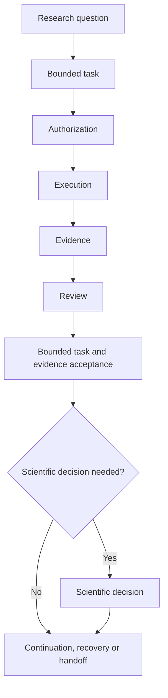

# The research workflow

A researcher starts with a question and a method, including assumptions about data or simulation. They identify provenance and the evidence needed to challenge the claim. A bounded AI-assisted task may inspect a small surface, run a permitted calculation, and report observations with limits. Independent review tests the evidence and omissions. The responsible human decides whether to accept a result.

The [synthetic measurements](../../examples/repeated_measurements/README.md) make this sequence visible without real scientific authority. A weighted mean is a calculation under a stated model; a successful command does not settle whether that model represents real data. Reproducibility makes scrutiny possible. [Evidence and acceptance](evidence_reproducibility_and_acceptance.md) separates those steps.

The [tutorial route](../index.md) introduces installation mechanics only when needed to reproduce and review work. Current execution and prompt rules live in [AGENTS.md](../../AGENTS.md) and [CPC.md](../../CPC.md).

When the question relies on earlier analysis work, consult the
[operational workbook](../operations/index.md) for a qualified artifact reference
or a justified lesson. Follow the playbook to the procedure maintained by its
native owner, then bind the selected inputs and local settings to the proposed
task. A method describes how the work is done; the playbook helps locate it.
The report records this attempt's consumed versions, proposal, observations and
missing checks. It remains separate from the workbook's reusable knowledge.
[Tutorial 7's optional BTV practice](../tutorials/07_coordinate_a_multi_repository_change.md#optional-btv-practice-from-reference-to-bound-proposal)
lets you prepare that evidence transfer without running an analysis.

Maintaining the collection is ordinary work within an already authorized scope:
add the new evidence's source, applicability and limits, and state precisely
which earlier use it supersedes. A later report does not update the collection
automatically. The native procedure keeps one owner, and neither a reusable
entry nor its maintenance supplies scientific acceptance or execution permission.

The completed route adds a bounded note, independent review, a narrow continuation, sequential evidence transfer to a separate methods repository, an intentional stop, and a handoff. [Task lifecycle](task_lifecycle.md) explains why the next step depends on the last accepted evidence and current live state.

## From a question to the next bounded task

The sequence is question, bounded task, authorization, execution, evidence,
review and a separate bounded task/evidence acceptance decision. A scientific
claim additionally needs the responsible scientific decision. Review may leave
a finding unresolved; neither a successful command nor a review recommendation
supplies acceptance. Continuation, recovery and handoff preserve valid evidence
and identify the next authorized delta.

The [direct authoring guide](../how_to/write_a_prompt_manually.md) turns an
authorized question into a complete task and the author's chosen run
configuration, delivered together. The task states the scientific choices and
permitted actions; the configuration states how this attempt will run. Derive
the Mermaid diagram from the task's stated dependencies. The diagram shows
dependencies; it does not authorize actions. The author reviews the meaning
before delivery. Before acting, the executor checks the current repository,
inputs and permissions needed for that action. Returned evidence then supports
review and a separate human decision. Retain the contents, observations and
limits in the existing report for continuation.
