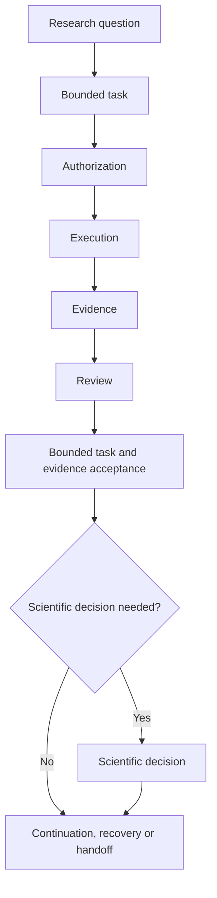

# The research workflow

A researcher starts with a question and a method, including assumptions about data or simulation. They identify provenance and the evidence needed to challenge the claim. A bounded AI-assisted task may inspect a small surface, run a permitted calculation, and report observations with limits. Independent review tests the evidence and omissions. The responsible human decides whether to accept a result.

The [synthetic measurements](../../examples/repeated_measurements/README.md) make this sequence visible without real scientific authority. A weighted mean is a calculation under a stated model; a successful command does not settle whether that model represents real data. Reproducibility makes scrutiny possible. [Evidence and acceptance](evidence_reproducibility_and_acceptance.md) separates those steps.

The [tutorial route](../index.md) introduces installation mechanics only when needed to reproduce and review work. Current execution and prompt rules live in [AGENTS.md](../../AGENTS.md) and [CPC.md](../../CPC.md).

The completed route adds a bounded note, independent review, a narrow continuation, sequential evidence transfer to a separate methods repository, an intentional stop, and a handoff. [Task lifecycle](task_lifecycle.md) explains why the next step depends on the last accepted evidence and current live state.

## From a question to the next bounded task

The sequence is question, bounded task, authorization, execution, evidence,
review and a separate bounded task/evidence acceptance decision. A scientific
claim additionally needs the responsible scientific decision. Review may leave
a finding unresolved; neither a successful command nor a review recommendation
supplies acceptance. Continuation, recovery and handoff preserve valid evidence
and identify the next authorized delta.

The [direct authoring guide](../how_to/write_a_prompt_manually.md) connects an
authorized question to a complete task and the author's chosen run configuration
in one delivery. The task defines the scientific and effect boundaries; the
configuration selects how this attempt will run. A derived Mermaid view makes
real dependencies inspectable without granting effects. Author review checks
meaning, runtime checks establish current applicability, and returned evidence
supports a separate review and human decision. The existing report retains
contents, observations and limits for a later continuation.
