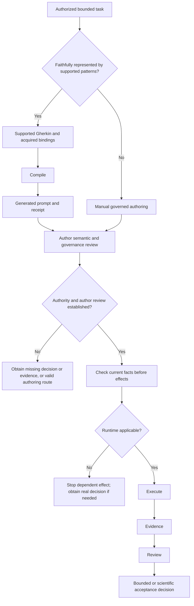

# Prepare a prompt with the governance workflow compiler

The governance workflow compiler is an optional authoring aid for supported
workflow patterns. It prepares an inspectable CPC prompt and a YAML compilation
receipt. It does not create authority, dispatch a prompt, perform an effect,
evaluate execution evidence, review or accept a result. Manual governed authoring
remains first-class for any task within the manual contract, including patterns
the compiler cannot represent. Current `refs/heads/master` remains the normative
policy source for prompt validation.

## Choose the authoring route

Start with the already-authorized bounded task. If the supported workflow patterns can
represent its behavior faithfully, supply supported Gherkin plus acquired
bindings and compile an inspectable prompt and receipt. Otherwise use the
[first-class manual governed route](write_a_prompt_manually.md). Do not weaken
the task to fit the compiler or infer that an implementation gap is task failure.



In prose: authorized task → supported Gherkin/bindings and compilation, or manual
prompt → author review and established authority → current execution checks →
applicability → execution → evidence → review → acceptance as
applicable. If author review is incomplete, obtain the missing decision/evidence
or use a legitimate fallback. If runtime is inapplicable, stop the dependent
effect and obtain a real decision when needed. No arrow supplies permission.

| Boundary | Responsibility and limit |
| --- | --- |
| Author | Fix authority, repository/role semantics, scope/effects, real choices, validation and stop boundaries. Review the exact prompt against current master. |
| Before execution | Establish authority and author review, then check current applicability before effects. Compilation and lint do not establish those decisions or checks. |
| Runtime | Verify consumed current branch/HEAD, dirty/index/conflict, worktree and master facts against the fixed semantics. Do not choose new authority, widen scope or settle a new scientific/governance choice. |
| Result | Execution produces evidence. Review challenges it; the responsible decision-maker separately accepts the bounded evidence or scientific claim. |

## Invoke the compiler

Use the Python wrapper and interpreter resolved from the local YAML profile:

```bash
"$wrapper" "$python_interpreter" tools/governance_workflow_compiler.py \
  --feature task.feature --bindings task_bindings.yml \
  --prompt-out generated_prompt.md --receipt-out compilation_receipt.yml
```

Enter the declared command directory successfully before checking output
collisions and invoking the command in that same effective context.
The two output paths must be distinct and absent as path objects: existing files
and dangling symlinks are rejected. Each file is created exclusively, without
overwrite. The pair is not a global atomic transaction; a race or failure while
creating the second output can leave a partial task-owned artifact. Inspect
actual outputs before any recovery or retry.

An intermediate compilation artifact may use a local name such as
`generated_prompt.md`. A prompt artifact delivered for dispatch follows the
`CODEX_PROMPT*.md` convention. Its name grants no execution authority and does
not require an executor receiving prompt text to reconstruct a companion file.

Policy and the maintained validator are acquired from one frozen
`refs/heads/master` Git snapshot, including repository modules. Checkout edits
cannot change those inputs. By default the selected repository is the compiler's
Git repository, including its shared refs when invoked in a linked worktree.
Use `--policy-repository /exact/trusted/repository` to select a separately
acquired policy repository. That selection is trusted code input, not an inert
data directory: validator
Python bytes from its selected master snapshot execute during mechanical lint.
It does not authenticate repository ownership, owner authority or semantic
correctness. Select only an independently trusted policy repository.
The receipt records the observed master OID and consumed blob identities.
No expected master OID must be authored. Before returning a prepared prompt, the
compiler compares all consumed policy dependencies with current master and
stops if any changed. An unrelated master commit does not itself invalidate
the snapshot. Validator bytes come from the same snapshot and retain their
limit to mechanical checks.

See the [architecture explanation](../explanation/governance_workflow_compiler_architecture.md)
for the typed result graph and independent safety verification.

## Author path for an already-authorized task

Write the semantic task first: premises, requested actions, observable outcomes,
negative boundaries and their dependency graph. Use the supported Gherkin subset
and diagram rules below. Keep the owner's actual task wording and distinguish
an independent result from a later review, composition or commit. The graph
expresses those dependencies; it does not choose workers, worktrees or commands.

Use this division of responsibility:

| Participant | Input or responsibility |
| --- | --- |
| Task author | Already-authorized behavior, exact substantive scope, semantic dependencies, observable outcomes and explicit exclusions |
| Trusted upstream binder | Acquired owner/evidence claims, repository and target roles, existing CPC context and the exact positive effect inventory |
| Compiler | Supported execution shape, modes, stage bodies/order, local grants, gates, commit mechanics, trace and generated workflow diagram |
| Executor | Current-governance review, scoped runtime preflight, authorized effects and result readback |
| Responsible decision-maker | Acceptance of the returned evidence and any new substantive decision |

Reuse the task's acquired binding and CPC context at the binder boundary. The
task author need not reconstruct generated CPC fields, technical stages or Git
commands, nor predict future commit OIDs. The CLI still requires separate
binding YAML; it does not acquire owner authority, discover a trusted context
or convert arbitrary prose into one. If a required context or material binding
is missing, stop for that input or use a separately authorized manual workflow.
Do not fill the gap with a guessed owner decision or an invented observation.

For a supported bounded task:

1. Preserve the semantic source and its graph. Bind each real effect to its
   existing positive authority, repository and exact target; keep negative
   scope in the current governed context.
2. Keep genuinely material premises separately represented, with their own
   provenance and actual consumers. A source premise that only restates
   already-bound task/governance constraints may remain traced without a
   duplicate executable evidence binding. Its underlying obligations remain
   material in their authoritative channels. Recognized live identity premises
   still need their explicit materiality/dependency binding and supported
   resolver; source prose cannot replace missing effect authority.
3. Run the maintained CLI above with the acquired context. Do not author
   `stages` or supply a second technical plan: supplied stage prose is inert.
4. Review the exact generated prompt, receipt and diagram against the source
   and current governance. Check semantic dependencies separately from physical
   scheduling, exact local grants, negative scope, material evidence gates and
   foreign-work controls. Mechanical lint is only one check.
5. Dispatch only after existing owner authority and separate author-side
   conformance review are satisfied. At runtime, verify current applicability
   and acquire branch/resource/index state where the effect consumes it before
   execution. Retain distinct execution and result evidence. Compilation proves
   none of these runtime checks or acceptance decisions.

For the supported controller-local fork/review/commit shape, independent
writers have disjoint tracked targets, feed one read-only review join and then
one separate commit on an existing bound branch. Delegation is forbidden and
one existing repository/worktree/ref carries the work. The compiler schedules
these writer actions serially without adding a semantic writer-to-writer edge.
Each writer freezes and reviews its own outcome; the join cannot hide a failed
writer behind the other result. Writers receive no index/ref commit effect;
the commit stage receives only the exact accepted union's index/ref mechanics.
The input must declare `branch_policy: continue_existing_branch` and a
`target_branch` matching the exact existing branch/ref contract. Branch creation,
a read-only policy or a missing branch choice is outside this shape; the compiler
does not silently convert it to continuation. Outer branch fields are removed
for orchestration only after validating that input contract. Do not introduce
worker carriers or branch creation to express this shape.

A source line, tag, graph edge or receipt grants no permission. Unsupported
syntax or an unrepresented action reports its actual implementation boundary;
missing authority/evidence retains its own stop. Do not rewrite the task or
widen the effects to obtain a conforming compile. A new substantive decision
returns to the owner. The existing manual guides linked below remain available
under their own authority; a fallback is not automatic execution permission.

Standard Gherkin is the human semantic contract: the feature and scenarios
describe premises, requested actions, observable results, and negative
boundaries. This implementation supports `Feature`, documentary `Rule` grouping, `Scenario`, `Given`,
`When`, `Then`, `And`, `But`, comments, blank lines, and feature/scenario tags.
`And` and `But` inherit the preceding step's role. Free-form descriptions may
contain the required ASCII diagram. Standard constructs whose semantics are
not implemented, including `Background`, `Scenario Outline`, `Examples` and
the standard `*` step, stop with a line-referenced `IMPLEMENTATION_GAP`. The `*`
step cannot disappear as documentary prose. Other unsupported English aliases
also fail closed, but may receive a generic input/compiler-invariant result;
not every unsupported alias has the same classification. Parser limits do not
establish a
canonical capability boundary. This is a bounded subset,
not a full Gherkin implementation. Tags remain visible as classification and
routing hints; they never grant authority or select production by themselves.

The separate binding YAML supplies acquired authority and evidence facts,
repository identities, exact scopes, a CPC context, and, where needed,
requested effects and exact workflow identity facts. Each material binding
names its source identity, acquisition state, validity scope, and exact effect and target if it
authorizes an effect. Effect-authorizing and consumed scalar bindings use typed
`repository_id`; an observed relation may carry `observed_state.value.repository`.
Where both are present they must agree with the selected repository.
`validity_scope` is documentary context, not a repository selector or a parser
for affirmative/negated repository prose. Unconsumed documentary facts do not
need irrelevant repository fields.

Explicit `read_only` and positive tracked/index/ref/storage scope cannot cover
the same canonical resource, including ancestor/descendant overlap, without an
explicit canonical override contract. A positive grant never silently overrides
a denial; unsupported override shapes remain outside the compiler subset. These
are contract checks, not OS sandbox or filesystem enforcement.

Permission-map scalar values accept only unquoted YAML boolean forms
`yes`/`no` or `true`/`false`, in their YAML-recognized capitalizations. Numeric,
null, quoted-string
and legacy `on`/`off` forms are rejected. `allowed_to_modify` remains a structured
repository mapping. Mechanical prompt lint does not certify nested grant semantics.

Gherkin premises are not proof. A positive effect needs
an acquired owner binding plus the exact current CPC permission and
path/ref/action scope. The compiler selects the minimum supported execution
shape and mode from the behavior and bound context. For the bounded two-writer
and two-repository provider/consumer patterns, it constructs stage roles,
ordering, bodies, gates, commit closure, local grants and provenance. Any
supplied `stages` are an inert historical reference; their goals, modes, grants,
gates and ordering do not become the executable plan. Supply stable worker
branch/worktree bindings in `worker_contract`, repository and branch roles in
`repositories`, and exact deletion/preservation resource bindings in `retirement`.
Git observations are optional tracking evidence; future results are stage outputs. The planner binds later stages to prior observed outputs rather
than assuming planned result heads are observed facts. An independent
review stage requires compatible delegation. A supported tracked writer needs
an exact owner-bound local ref effect and index/ref scope for commit closure.
An authorized effect alone cannot request integration: the `When` must request
integration or advancement. Commit closure for a tracked edit is a necessary
governance mechanic even when the `When` does not say `commit`. Every generated
stage records its semantic role and whether it comes from requested behavior
or a necessary governance mechanic.

Git HEADs, commit OIDs and ref OIDs are runtime evidence by default. They do
not establish authority and need not be authored before an effect produces them.
Carrier relations bind repository, exact worktree path and attached branch;
unconsumed documentary historical HEAD/base fields are tracking-only. An
`IDENTITY_CRITICAL` or `DECISION_MATERIAL` identity with a concrete dependent
effect and harmful mismatch retains its gate and blocks only that consumer.
A wrong repository/path/ref/owner still fails closed.

The existing `stage:<producer>:<output>` convention transports a produced
reviewed result to its actual consumer. A typed `Result_ref` decodes this
transport at the IR boundary. `Stage_spec` and `Result_graph` establish unique
output identities and require every input to name an available earlier output.
Dependency trace and visualization consume this same graph.
Exact reviewed-result and exact-union
base provenance remains necessary when those bytes are consumed. It is not a
requirement that a historical carrier still has its old HEAD. Integration binds
the reviewed source result, freshly reads its target, and requires clean state,
fast-forward ancestry and no movement after that local readback.

Retirement separates portable preservation, ordinary worktree removal, absence
readback and ref deletion. A deletion stage reads its exact current ref OID
immediately before compare-and-delete and uses that observation as the command
operand. The generated `stage:<delete-stage>:pre_delete_ref_oid` operand is a
runtime value to resolve from the emitted observation, not literal shell text.
A failed comparison stops: never refresh the operand or retry blindly. Earlier
commit results may be cross-checked against the fresh value where the exact
preserved result is consumed. No persistent OID registry is used.

For every bounded parallel-writer composition followed by integration, supply an
exact `common_validation_contract` with a named `tests/...py` `test_target` and
the composition branch as `target`. Add one acquired `accepted_evidence`
relation under `common_validation.target_relation` that binds the locator,
repository, controller worktree/branch, generated result head and claimed
coverage of exact union and common validation. The frozen outer validation
ceiling must be `targeted_unit_test`. The compiler derives the `must_pass` rule;
the caller cannot supply failure semantics. Missing, failed or unreadable results, or results for a different proposed
revision, block dependent stages. The stage carries exact
branch, worktree and generated-head posture. Without the relation, or for an
unrecognized material `Then` clause, compilation fails closed.
This mechanic follows from the requested composition and permanent advancement,
represented as semantic dependency edges, even when
the assertion only requests review of the exact union, composed result, or
combined worker results. Mentioning validation in a title, comment or documentary
premise creates no gate. The verifier independently checks the proposed result → common
validation → integration order and the explicit evidence dependency; missing
contracts or removed dependencies fail closed. The provider/consumer plan
validates its proposed result tuple before separately requested permanent advancement.
Workflow mode and effect inventory cannot supply that behavior. The bounded
two-writer action grammar recognizes editing/writing disjoint files, integrating
or advancing the target, and retiring/removing temporary branches. The assertion
must identify the reviewed exact union, composed result or combined worker
results. Mere mentions or negation do not request integration. A bounded partial
two-writer workflow emits only the requested composition/integration/retirement
roles. Unrepresented parallel clauses report a compiler implementation gap.
The provider/consumer preparation pattern without permanent advancement is an
orchestrated plan without this composition/integration dependency and emits no
common-validation stage. Generic assertions such as `success`, `output exists` or `result is ready`
require an evaluable evidence contract and report missing decision-material
evidence; they do not establish architectural uncertainty.

The supported two-writer continuation has one accepted writer result from an
exact prior artifact and common base, one invalidated writer,
and disjoint protection and delta scopes. The accepted writer is absent from
executable stages; its exact reviewed portable result feeds the rebuilt union.
The historical writer branch, worktree and current HEAD are not reacquired or
serialized as join preconditions. Later carrier observations are documentary
unless an explicit invalidation rule makes them material; they cannot replace
the accepted result. The compiler repeats the invalidated writer and dependent
review, union, validation
and requested integration/retirement stages. Contradictory protection requires an owner decision; broader protected
continuations that the delta planner cannot express are implementation gaps.
Tracked paths, index paths, commit scopes and exact unions share one
repository-relative lexical identity. Absolute or empty tracked targets and raw
`..` traversal are rejected. Redundant separators and `.` components normalize
to the same operational identity; original spelling may remain receipt provenance.
Declared-disjoint writers cannot have canonical equality or ancestor/descendant
overlap in either direction. Identical relative paths in different repositories
remain repository-local.
Local carrier relations and global isolation are separate checks. For parallel writers followed by composition, the
compiler compares normalized lexical worktree paths and repository-local mutable
refs across active writers and the controller, and excludes the permanent
integration target from those source refs before common validation. For provider/consumer preparation,
it compares source worktrees with each other and with both repository roots;
repository roots may share a location when neither carries a proposed result.
Source branches remain repo-local and follow their distinct native
namespaces. Equal branch strings in distinct repositories do not establish an
alias. The receipt records local
relation consistency, cross-role isolation and cross-repository isolation.
Equal or nested declared-isolated carrier roots are rejected in either direction.
The lexical/component check does not follow symlinks or prove universal realpath
or hardlink isolation; that
remains with acquired binder and runtime evidence. `acquisition: acquired` is
an upstream trust assertion, not compiler authentication. Unimplemented safe
cases fail locally and leave the manually governed workflow available.
Automated provider/consumer lowering supports only `topcoffea -> topeft`.
A different or reversed pair is outside this subset and may use manual governed
authoring. Additional owner evidence does not expand compiler capability.
The bounded provider/consumer planner starts from `NOT_STARTED`. The action
`provider and consumer write candidates` stops at a validated repo-local
proposed result pair. Adding `and integrate` requests sequential permanent advancement
of the provider and consumer after independent review and common pair validation.
Each repository must already have an
authorized source worktree and branch in its native feature namespace, with exact
relation between its permanent starting point and proposed result, plus local
write/ref authority. The compiler
does not create a carrier. For advancement, each repository explicitly binds
`permanent_target_branch` to its native live branch, distinct from its source branch.
An acquired `repositories.REPO_ID.permanent_target` relation binds repository,
worktree, attached branch and head; each `integrate_REPO_ID` stage needs its own
exact local-ref effect and owner binding within that repository's scope and
the envelope. Authority over a proposed result alone cannot supply this grant.
A `pair_validation_contract` names a test locator and covers
provider, consumer and common contract; an acquired tuple relation binds that
locator to both generated result heads. The validation stage must pass on
the exact pair. Permanent stages consume that evidence and both proposed result
identities. Their pre-effect gates require exact source/target readback, a clean
index/worktree and fast-forward ancestry. The consumer additionally requires
the provider's observed advancement. Each stage preserves proposed result/effect
evidence and stops downstream work on failure. A failure before the effect and
`OUTCOME_UNKNOWN` have distinct outcomes; the latter requires authoritative
repo-local readback before any separately authorized retry. No global
transaction, automatic rollback, retirement or publication is generated.
An observed partial or completed state yields a diagnostic
that preserves the supplied partial-effect record and requires a separately
bound continuation or recovery plan. It does not replay the initial stages.
Other dependent or unfamiliar action patterns fail closed as compiler
limitations. The author must inspect the generated Markdown and receipt
against live governance before any separately
authorized dispatch.

`dispatch_gate` names `owner_authorization_binding` and
`manual_governance_review_binding` for acquired owner authority and
conformance evidence. They are distinct from compiler/linter success; faithful
translation of already-authorized behavior does not require another owner
approval. The optional historical `live_applicability_binding` remains
provenance and is not a universal dispatch gate. Lack of author live-host
access does not force a draft when the semantic target,
repository/worktree/branch roles, effects and required runtime checks are
unambiguous. The generated evidence requirements assign current governance and
scoped state acquisition to Codex before the dependent effect. Establishing
authority and author review permits entry to those current execution checks; it
does not prove that they passed. Missing authority or conformance evidence still
prevents the prepared prompt from being issued for execution. A structural or authority failure writes only a diagnostic
receipt. A material `Given` without evidence or a usable preflight may produce
a prepared prompt with the dependent effects excluded. A simple prompt is atomic
and cannot be issued for execution in that case. For a staged workflow the existing
`Result_graph` must have an unblocked entry root: only then may the CLI return
`COMPILED_CONFORMING_CANDIDATE` and, with owner/conformance bindings,
record eligibility for current execution checks in the receipt. This allows
independent governed progression, not completion of
the whole chain. `stage_readiness` projects initial preflight entry roots, local
blocked effects and blocked predecessors; it supplies no runtime outputs.

Map insertion order is normalized before planning and serialization.
`candidate_pair_order` remains semantic: it must
name provider then consumer. Writer path unions are set-like and normalized in
the plan. A simple prompt's positive executable path/ref scope is checked in
reverse against the exact requested effect and repository-local authority
binding; an extra path or lifecycle category is rejected.

For effect-local readiness, `given_bindings` maps a `Given` source line to a
binding. The binding may name `dependent_effect_ids`, `material_reason`, and
`runtime_preflight`. Preflight prose is inert, including a string starting with
`verify`. An unconsumed or documentary historical ref-value observation is
tracking-only. A materially consumed ref identity retains its supported checker
and gate; legitimate ref movement does not erase an exact-parent requirement.
Every premise is classified as `already_acquired_material_fact`,
`runtime_preflight_requirement`, `non_material_documentary_premise`, or
`unsupported_material_premise`. Documentary premises remain traced without gates.
A linked material premise names its dependent effects; unsupported properties
exclude those effects and emit an unresolved `must_pass_before_effects` input
on their actual consumer stage. All stage inputs precede every effect of that
stage; effect eligibility cannot split or bypass a stage. No blocked stage
publishes outputs, so its typed descendants cannot run. Already modeled
independent roots may enter governed preflight and progress under their own
exact grants. Missing facts never become PASS. An unsupported input has no
invented executable check: it must be acquired and revalidated before its
consumer can run. Without any unblocked entry root the workflow remains
unable to enter execution checks and the CLI exits nonzero. Runtime Git/index/dirty-state prose
is emitted only for workflows with Git lifecycle effects; read-only inspection
retains only the common current-rule, target, material-fact and retry duties.

The bounded Git properties are `the selected commit branch is checked out`
(also `the current branch is the selected commit target`) and
`ref refs/heads/<branch> names commit <oid>` (also
`refs/heads/<branch> resolves to <oid>`). The compiler binds these to the same
repository and local ref consumed by the declared dependent ref effects.
It derives `git symbolic-ref --quiet HEAD` or `git rev-parse --verify <ref>`,
the effect carrier, expected value and exit/stdout comparison. Writers use their
worktree, composition uses the controller worktree, and provider/consumer preparation uses the repository-local
proposed result. A simple repository-local effect uses its declared repository path.
A Given on permanent integration needs a separate acquired
`worker_contract.integration_target_carrier` relation containing `repository`,
`worktree`, `attached_branch` and `head`; a repository root is not a fallback.
These are unexecuted verification descriptions, not acquired evidence or grants.
The check is emitted under `must_pass_before_effects` in stage inputs or simple
prompt evidence requirements, never as a post-effect stage acceptance gate.
An acquired material fact, from `repository_readback` or `accepted_evidence`,
must carry the exact `observed_state`: `property`, `repository_id`,
`working_directory`, `target`, `observed_value`, `argv`, `comparison`,
`source_identity`, `validity_scope`, and sorted `dependent_effect_ids`.
For a consumed branch/resource premise, the observed value must equal the required value; mechanism and evidence context
must also match. Changing a locator without rebinding its observation is not
silent evidence equivalence. The emitted stage consumes this exact acquired
record without adding a redundant preflight. Contradictory acquired records,
including wrong-carrier observations, exclude only their dependent effects.
Pending, superseded or invalidated current-state observations need a fresh
compiler-derived check. Generic live-applicability evidence proves no exact fact.

This continuation also recognizes `accepted writer writer_b result names commit <oid>` (or
`writer_a` when that is the protected writer). Link it to the existing exact
`q04.accepted_writer_result` accepted-evidence relation, with dependencies on
the consuming exact-union effects. The source must be the continuation's exact
prior artifact, with the matching result/head/base/review identity and
validity scope. The accepted writer must remain outside the invalidation
boundary. This premise consumes the portable result, so movement or retirement
of its historical carrier triggers no new readback. It does not assert that
the old branch still has that value. Expired or contradictory portable
evidence is not reusable; a current repository readback cannot replace the
accepted result. Exact-plan premises (`isolated worktrees`, `exact bases`)
continue to consume the existing acquired carrier relations. Unknown unbound
prose is documentary; authors must bind material premises, and recognized
identity assertions cannot silently fall back to documentary status when
unbound. No future HEAD/SHA literal is required. Ordinary historical HEAD/hash
drift does not create a gate. Exact runtime model identity is also tracking by
default: ordinary `not_observable` requires no nonmateriality annotation. An
explicitly material profile comparison requires observable identity and the
CPC `required_profile_agreement_evidence` with
`profile_agreement_failure_policy: fail_closed`; the binder remains
responsible for the evidence claim. No receipt authenticates it or permits a
silent switch. Exact reviewed-result provenance remains required where a
downstream operation actually consumes that result; destructive ref actions
use a fresh local observation. The supported negative assertion `no remote
repository is modified` rejects contradictory remote effects. Every material negative assertion needs a recognized checker/evidence contract
in the selected shape; a trace edge alone is not enforcement. Unrecognized
negative assertions stop with `IMPLEMENTATION_GAP` rather than becoming
decorative trace edges.

Every successful receipt binds the SHA-256 of the prompt, raw binding input,
compiler source, applicable live governance, and maintained validator source.
It records the validator locator and version. Regenerate affected final samples
after source changes; old receipts remain historical evidence.

The compiler resolves each selected repository module from the live typed
registry. TOPEFT and TOPCOFFEA prompts carry all four native branch-role fields;
an out-of-role development branch or feature namespace fails closed. A matching
feature namespace never grants branch creation. The generated prompt also names
the applicable repository-native policy requirement. Conditional Git,
orchestration, evidence, recovery, model, production and reviewer-prose rule
families are recorded in the receipt with their live source hashes.

The compiler checks the current serialized closed fields against live sources:
typed repository IDs and their prompt scopes, prompt/stage mode, branch policy,
validation ceiling, model, reasoning, delegation, dirty-worktree and preflight
policy, patch kind, foreign-work and staging policy, workflow stop policy,
integration method, publication action and duplicate policy, and production
execution owner. When the applicable source cannot establish an allowed value,
compilation fails closed.
The receipt evaluates traceability across semantic steps, authority/effect
bindings, emitted stages and mechanics, and post-execution evidence paths;
missing material edges prevent a conforming prompt. It emits the evidence and
evaluation contract, but does not ingest execution evidence or evaluate
acceptance. `patch_kind_expected` is checked against the whole plan:
read-only plans use `empty_no_changes`, and supported tracked mutation plans
use `prompt_local`. Other patch kinds are unsupported until exact provenance
semantics are implemented. The maintained prompt validator checks mechanical
validity and internal consistency only; governance completeness remains unassessed. A
generated prompt, receipt, or validator PASS proves neither dispatch nor
execution, review or acceptance. Functional checks cover simple bounded work,
minimum-sufficient execution and manual governed authoring, as well as separable
work and join, continuation, accepted result preservation and lifecycle,
dependent repositories, and governed multi-action sequences. These checks concern
the supported patterns; they do not imply support for arbitrary workflows or
require equivalence with historical manual workflows.

The compiler trusts the upstream acquisition/binder layer's `acquired` claim.
Gherkin text never creates acquisition or authority. `source_identity` records
provenance/locator identity; exact `observed_state` relations are required for
identity-critical planning. The compiler does not independently authenticate
or byte-verify each source. External review must retain that trust boundary;
using the compiler does not erase it.

If the compiler cannot express a manually valid task, use the existing
[manual prompt guide](write_a_prompt_manually.md) and
[prompt validation guide](validate_a_prompt_before_execution.md). A compiler
limitation does not revoke an independently valid manual workflow.

## Execution shape and architecture boundaries

Behavior selects the execution shape before effect authority is checked. An
inventory of authorized effects cannot request an additional stage. Parallel
writers may end after independent review, after reviewed composition, or after
requested integration and terminal retirement. Common validation without
integration is emitted when explicitly requested by the observable contract.
Other partial shapes do not invent it. Composition followed by integration
requires common validation before the permanent target advances. The supported
assertion for independent results is `writer results are reviewed`.

The compiler distinguishes `SUPPORTED_EXECUTION_SHAPE`, `IMPLEMENTATION_GAP`,
`UNSUPPORTED_CANONICAL_CONSTRUCT`, and `ARCHITECTURE_BOUNDARY_UNRESOLVED`.
A rejected live closed-vocabulary value is a canonical boundary. Missing facts
and authority retain their corresponding NOT_READY results. A material result
clause without an evaluable evidence contract is missing evidence. A malformed
input or unknown effect-inventory key violates the input contract, independently
of architectural support. Recognized standard Gherkin constructs without lowering
and unrepresented
coordination grammar are implementation gaps. Other unsupported aliases may fail
closed under a generic input/compiler-invariant classification. These distinctions
come from the failed semantic/input obligation, not an error-message or
caller-supplied classification. An action with no established canonical behavior
or execution contract remains `ARCHITECTURE_BOUNDARY_UNRESOLVED`. This does not
mean that canonical governance forbids it. Permanent provider/consumer
advancement is supported by the bounded plan above when its separate local
authority and exact evidence bindings are present; missing bindings do not
turn it back into an architecture question.

Boundary receipts include the semantic pattern, affected steps and effects,
attempted execution shape, source/section, missing capability, decision options
and a precise next boundary. Current canonical governance owns the actual
permission and vocabulary contracts. These compiler classes neither revoke a manually
valid workflow nor authorize its execution. A receipt can identify a gap
without claiming that the supported architecture has been fully implemented.

## Material evidence validity

A linked material Given records a `validity_relation`: claim, evidence identity,
validity scope, consumed property, dependent effects and exact carrier
comparisons. The compiler selects the carrier relation by the effect's generated
role. It projects only the property used by the premise and compares that with
the required observation. A generic live-applicability binding cannot supply
this relation. Conflicting observations exclude only dependent effects, even
when the old observation is acquired accepted evidence. Both accepted evidence
and repository readbacks can establish a premise within their validity scope.

For example, a documentary historical local-ref value A is tracking evidence
when the same carrier now has value B. If a consumer instead requires reviewed
parent A and writing on B would violate that relation, the material mismatch
blocks that consumer. This does not freeze every historical OID or reacquire
unrelated carriers.
A changed branch attachment still invalidates a premise about the selected
commit resource. HEAD movement does not invalidate that branch premise. Movement in another
writer carrier is irrelevant. For a simple prompt an optional exact relation
`repositories.<repository_id>.current_carrier` carries `repository`, `worktree`,
`attached_branch` and `head`; it is compared only where the effect consumes the
corresponding property. No new observation is fabricated when that relation is
absent. Portable accepted writer results have their own result/base/review scope;
historical branch movement or disappearance does not enter current-carrier
comparison and cannot force reacquisition of that retired carrier.

## Plain ASCII workflow diagrams

Each supported contract includes one Markdown `text` fence in a free-form
Feature, Rule or Scenario description, before its steps. Each step has a unique
ordinary prose label `[G1]`, `[W1]`, `[T1]`, or another ASCII identifier. These
labels are references, not Gherkin keywords or authority. The `derived_` prefix
is reserved for generated nodes. No renderer, external dependency, or separate
`Edges:` list is used.

````gherkin
Feature: bounded inspection
  ```text
  [G1] --> [W1] --> [T1]
  ```
  Scenario: inspect one document
    Given [G1] the document identity is acquired
    When [W1] I inspect the document
    Then [T1] the report cites evidence
````

### A compiled reader example, without dispatch

The three-step source above was compiled once as a bounded read-only inspection
of `docs/explanation/research_workflow.md`. It uses the maintained simple task
class, with neither `Background` nor `Scenario Outline`. The separately acquired
binding context authorized preparation of this example only, not execution.
It supplied the resolved local repository path, the selected document and its
recorded pre-compilation identity, no requested effects and no dispatch-gate
bindings. No owner or conformance approval for child dispatch was invented.

The substantive CPC portion of that binding file was:

```yaml
prompt_mode: investigation_only
branch_policy: read_only_current_branch
allowed_to_modify: {}
read_only:
  TOP26006_fw:
  - docs/explanation/research_workflow.md
validation_ceiling: static_inspection_only
patch_kind_expected: empty_no_changes
heavy_command_permissions:
  network_access: false
```

This is an excerpt, not a complete binding file or execution prompt. An actual
author must acquire the task's own authority, provenance and resolved paths;
copying the excerpt creates none. The generic `Given` is traced as documentary
in this example, not as an executable acquisition check. The selected document
and its recorded identity are explicit in the CPC evidence context. A genuinely
material premise still needs its real consumer binding and supported check.

With the source and complete acquired binding file in the declared directory,
the maintained invocation has this form:

```bash
"$wrapper" "$python_interpreter" tools/governance_workflow_compiler.py \
  --feature reader_example.feature --bindings reader_example_bindings.yml \
  --prompt-out reader_example_generated_prompt.md \
  --receipt-out reader_example_compiler_receipt.yml
```

The recorded run also used `--policy-repository` to select the canonical checkout
sharing the linked worktree's refs. The observed receipt reported
`COMPILED_CONFORMING_CANDIDATE`, execution shape
`simple_non_orchestrated`, complete traceability, consistent visualization,
no authorized effects and `dispatchable: false`. Owner-authorization and manual
governance-review dispatch bindings were absent. Execution and result assertions
remained `NOT_EVALUATED`. The generated text graph retained `G1 → W1 → T1` and
added an external evidence/owner acceptance boundary with `effect: false`.
The generated prompt required current-rule and consumed-target/material-fact
readback before any dependent effect and left “the report cites evidence” as a
post-execution assertion. It did not acquire runtime evidence.

The maintained validator reported `mechanical_validity: true`,
`internal_consistency: true` and `governance_completeness: not_assessed`.
The child prompt was never dispatched. This demonstrates compilation, trace
and mechanical checks only, without claiming runtime applicability,
execution, review or acceptance. The Mermaid route above explains authoring;
the compiler consumes the ASCII source diagram, not Mermaid.

The source diagram describes semantic dependencies at the granularity of the
steps. Given premises feed actions; observable assertions depend on their
scenario's actions. Independent assertions are separate branches, not serial
validation gates. Multiple scenarios have no invented cross-scenario edge.
A compound action remains one semantic node; its generated execution diagram
expands the internal roles. To expose the parallel branch and composition in
both diagrams, use separate ordinary action steps:

````gherkin
Feature: parallel writers
  ```text
                +--> [W1] Writer A --+
                |                    |
  [G1] Given ---+                    +--> [C1] Union --> [I1] Integrate --> [R1] Retire --> [T1]
                |                    |
                +--> [W2] Writer B --+
  ```
  Scenario: disjoint writers compose and integrate
    Given [G1] isolated worktrees
    When [W1] I edit writer_a disjoint files
    And [W2] I edit writer_b disjoint files
    And [C1] I compose the exact union
    And [I1] I integrate the composed candidate
    And [R1] I retire temporary branches
    Then [T1] exact union is reviewed
````

The binding YAML still supplies exact acquired carrier identities, authority and
validation contracts; `requested_by_step` and `given_bindings` refer to actual
source line numbers, including description lines. The diagram supplies none of
those facts. The separate writer clauses explicitly request disjoint writers;
the graph cannot turn a serial action into parallel work. Composition,
integration and retirement clauses may be omitted when their effects are not
requested. Their corresponding authority inventory must then omit those effects.

The standard-library parser recognizes bracketed IDs, inert captions, horizontal
and vertical connectors, diagonal `/` and `\` segments, `+` junctions and terminal
`>`/`v` arrows. Align with spaces. Crossings must have an explicit junction;
broken wires, dangling connectors, unclosed fences, ambiguous directions,
unknown IDs and missing or additional dependencies fail with
`WORKFLOW_GRAPH_INCONSISTENT`. Inputs are bounded to 100,000 characters and a
2,000 by 2,000 grid. Repeated diagram IDs reference the same node, useful for
separate failure panels; semantic step definitions remain unique. The compiler
never derives behavior or authority from geometry.

Each generated prompt includes a text diagram and documentary correspondence.
Each receipt has `workflow_visualization.source_graph`, `generated_graph`,
`semantic_mapping`, `execution_mapping` and `consistency`. Nodes surviving from
separate semantic actions retain their source IDs. Compiler stages receive
explicit derived IDs and source/governance mappings. Local preflight edges reach
only the consuming effect stage. Failure panels show stop/preservation exits;
`derived_external_acceptance` is an external evidence and owner boundary, not a
new executable stage. Reused accepted-writer nodes denote portable results, with no
writer effect. The generated drawing is parsed again and compared against the
semantic/execution graph before a conforming prompt is returned. The receipt
retains the compiler, input, prompt and governance digests so that the graph and
its plan can be reviewed together.


## Bounded lifecycle and result extensions

An exact linked-worktree lifecycle is represented separately from local-ref
creation/deletion. `worktree_create` and `worktree_remove` are effect inventory
kinds using the existing `allowed_to_modify` grant; they add no permission key.
`lifecycle_contract` binds repository, repository path, worktree path, ref,
reference ref, ownership, clean/index/conflict/untracked/ignored/lock requirements,
portable preservation evidence and controller branch. Its future state is a
must-pass runtime condition, never an observation of successful creation.
The ordered planner derives preservation, ordinary worktree removal, absence
readback and exact old-OID ref deletion as distinct actions. Every path/ref
operation needs its own owner effect and stage scope. Cleanup failure cannot
erase a preserved semantic result. Force removal, prune and recursive filesystem
removal have no lowering. Attached creation additionally requires its separate
local-ref effect; detached creation does not confer ref authority.

A bounded ordered action sequence uses source-derived action kinds and exact
bindings, not caller-supplied stage prose or commands. Unsupported action kinds
and missing action bindings remain local failures. `ordered_action_bindings`
may bind exact reviewed edit paths/postimages and existing validation or
prepared-only handoff evidence. This is not an arbitrary workflow executor.
A one-file `deterministic_edit` followed by ordinary static validation stays
non-orchestrated. Its preimage hash, unique literal replacement and established
semantic source become explicit evidence requirements.

A writer without a requested local-ref effect can freeze uncommitted full
postimages and hashes only when an exact controller commit closes the result.
Its stage receives no index/ref commit grant. The accepted-result input still
requires an exact result identity; a commit OID must not be relabeled a
postimage digest. This extension does not automatically repair incomplete
historical carriers.

A dependent continuation can consume `accepted_effect_state`: exact proposed source
and target heads for the provider/consumer pair, completed stage identities,
review/validation evidence, consumer outcome and readback authority. One exact
accepted-evidence relation binds that whole state to the continuation artifact.
Protected proposed result preparation, validation and provider advancement are not
replayed. An unknown consumer outcome emits readback only; a certain pre-effect
failure can permit the separately authorized remaining consumer advancement.
No automatic retry or rollback is generated. Partial-state strings alone do
not establish that relation.

`commit_contract` binds an ambiguous local commit to its exact repository,
carrier, ref and index scope. An optional recorded base is evidence only. The output requires authoritative ref,
HEAD and index readback before any retry, with `automatic_retry: false` and
no new effect before explicit idempotence or recovery authority. Qualification
of this generated contract does not require manufacturing a Git failure.

These extensions prepare prompts only. Current functional qualification
requires review of the generated prompts and affected behavior; unit-test
success and a mechanical lint pass do not establish execution or acceptance.


### Identity audit and lifecycle policy

Worktree creation derives its branch policy and argv from one typed resource:
a new attached ref uses `create_feature_branch_from_reference`, while existing
resource actions retain their declared controller branch. Creation checks an
absent destination; it never requires a clean existing worktree at that path.
After creation, record the actual base/ref/HEAD. Before removal, check exact
registration, attachment, task ownership, clean/unlocked state, preservation
and absence of foreign content. No historical HEAD equality is a generic gate.

Receipt digests remain useful tracking evidence. They cannot grant an effect,
replace owner bindings, prove semantic equivalence or establish acceptance.
The one-file deterministic-edit preimage guard remains tied to that concrete
literal replacement; it is not a workflow-wide hash prerequisite. All emitted
readback commands and runtime operands are unexecuted specifications. Compiler
unit tests qualify generation, not actual lifecycle execution.

## Composing temporary resources and task stages

Ordered actions may bind a named resource through `ordered_action_bindings`
using `resource`, with resource identities in `lifecycle_resources`. Each
resource uses the existing lifecycle contract. Creation, modification, removal
and ref deletion still require separate exact positive owner bindings and
stage-local effects. Resource identity alone grants nothing. Ordered actions
follow the semantic source sequence; repository or provider/consumer labels
do not determine advancement order, and permanent anchors are never advanced
implicitly. Resource-local preservation and runtime result outputs survive
interleaved actions on other resources.

An ordered creation prelude may feed the existing parallel writer/review/join
body, expressed as either one aggregate clause or separate writer and join
steps. Every active writer depends on completed prelude readback; an ordered
epilogue depends on the completed body. Created carriers must belong to that
body. Existing carriers need no create effect. Grants remain separate at every
stage.

The compiler normalizes action ownership once, before planning. Its internal
partition binds source lines and semantic IDs to ordered resource actions or
parallel worker/join roles, with source-local effects, resource identity,
dependency edges and assignment provenance. Planning, trace verification,
stage serialization and graph projection consume that partition. The receipt's
`semantic_partition` records these assignments; it is evidence, not a new
authoring field or permission surface.

Existing worker-role clauses and `worker_contract` identify parallel behavior;
`effect.stage_id` and `requested_by_step` must agree with its source ownership.
`ordered_action_bindings` retain explicitly ordered resource edits even when
their wording resembles a worker clause. A line carrying both an ordered
binding and parallel-stage effects is rejected as contradictory typed ownership.
An English action verb alone never moves a worker into the ordered plan.
Unknown action behavior and lifecycle actions interleaved inside the parallel
body remain unsupported. The source diagram must show the prelude, independent
writer branches, join and optional epilogue; diagram geometry cannot supply
missing semantics or effect authority.

A prepared edit can name a later `deferred_commit_stage`. Its frozen postimages
and independent review feed that exact local commit. An explicitly ambiguous
commit records `OUTCOME_UNKNOWN`; a following exact Git readback resolves its
parent, tree, blobs, ref and index before dependent effects. No automatic retry
or global rollback is generated. Validation may consume only earlier stage
outputs. Accepted portable writer results may use `frozen_postimages` entries
with exact content hashes and locators plus base/review provenance, without an
invented writer commit.

Ordered validation contracts carry typed exact `cases`, each naming `provider`
and `consumer` produced-result operands and a frozen `expected` outcome of
`PASS` or `FAIL_EXPECTED`. Their `matrix` must agree with those case outcomes.
The supported predicate is `contract equality and protocol membership`.
Every operand must also be a declared earlier stage input. A matrix without
exact operands cannot qualify a tuple relation. The empirical fixture for dependent repositories
resolves and evaluates the generated cases, including the producer's
authoritative result after ambiguous-effect readback. It preserves the frozen
four outcomes and does not reconstruct a private tuple list.

Ordered safety verification checks action coverage/order, resource lifecycle,
fresh compare-and-delete commands and ambiguous-result readback directly from
semantic assignments and resource contracts. It does not call the planner to
confirm its own output. Authority, grant, repository and carrier checks remain
separate obligations; result-graph consistency alone proves none of them.

An ordered edit may reuse an exact acquired accepted-review relation through
`reuse_review_binding`. That relation binds the source action, exact paths,
reviewed postimages and review evidence. The generated stage preserves that
evidence and requires unchanged staged bytes; a changed result stops for
invalidation and review. This does not grant a write or adopt foreign work.


Reviewed artifacts have one internal `Artifact_spec`: repository-relative path,
SHA-256, review evidence and exactly one source. Bounded synthetic fixtures carry
UTF-8 literal content (at most 64 KiB); the digest must match those exact bytes.
Acquired artifacts carry a safe inert filesystem locator and digest, without
invented literal content. Legacy frozen locator/digest records normalize to the
same identity. Bare reviewed digests without a materialization source fail closed.
Locators are not fetched by compilation; an authorized executor must verify the
acquired bytes against the digest. Locator syntax excludes traversal and URLs.

Ordered stage declarations and the result graph project this relation. The
independent verifier compares source artifact evidence with generated records.
The empirical fixture obtains literal bytes from the generated contract, checks
exact Git blob readbacks for all four results, then evaluates the generated
validation tuples. Artifact identity proves no authority or historical equivalence.
