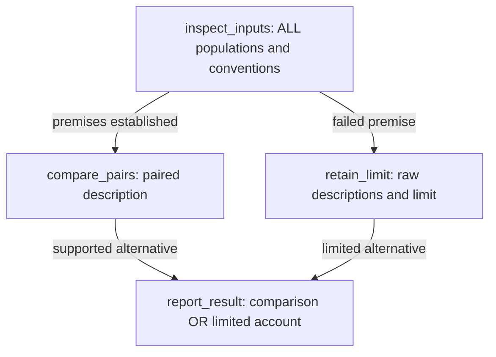

# Write a prompt manually

Start with the research question and the evidence needed to judge its answer.
Write the authorized task directly in natural language, using prose, tables or
fenced mappings where they make the scope precise. An authorized assistant can
help prepare it through the [task-preparation guide](ask_an_assistant_to_prepare_a_task.md).
The author remains responsible for the choices delivered to the executor.

This guide describes the direct path implemented in this candidate revision.
It does not assert adoption on master or in other workstreams. Actual dispatch
is governed by current `refs/heads/master` [CPC](../../CPC.md),
[AGENTS](../../AGENTS.md), the selected [repository module](../../governance/repositories.md)
and native policy. Candidate content cannot validate its own dispatch.

## Before you start

Identify the research lead's mandate and effect permissions, the scientific
question and responsible scientific lead, actual inputs and revisions, method,
assumptions and limits. State what observable result would answer the question,
including a valid negative or partial answer. Do not choose the scientific
meaning of a quantity merely to make the task executable.

Read applicable governance and accepted prior evidence. Bind the typed repository
identity, semantic target and installation profile; supply exact physical paths
when needed to remove ambiguity. The installation profile resolves local paths,
wrapper and interpreter. It does not choose the task, the model or permissions.

For project delivery, use one versioned `CODEX_PROMPT*.md` and keep its
filename alongside any integrity hash. This naming convention does not require
an executor receiving prompt text to reconstruct a local file; see the
[author/runtime validation boundary](validate_a_prompt_before_execution.md#author-validation-and-runtime-state).

## Write one reusable task

Use flexible semantic blocks with one authoritative definition of each value.
The candidate's eight named inputs are `prompt_id`, `task_revision`,
`decision_question`, `prompt_mode`, `delegation_policy`, `allowed_to_modify`,
`read_only` and `validation_ceiling`. They are an index into a complete task,
not a maximum field count or a substitute for its meaning.

Explain authority, input contents and conventions, method if selected, permitted
actions, observable result, checks, relevant failure behavior and acceptance
boundary. Apply the activity triggers: Git work needs its branch/action/commit
contract; evidence review needs its evidence rules; cross-mode dependencies,
production and long work need their respective conditional contracts. For an
ordinary task the sole positive grant map is `heavy_command_permissions`.
For an orchestrated workflow use stage-local maps and branch policies with a
non-authorizing envelope, under the [orchestration contract](../../governance/contracts/orchestration.md).
A mode, graph, model or filesystem capability cannot create an effect grant.

For a continuation, name accepted claims with their evidence and acceptance
provenance, then specify only the new delta, invalidation boundary and checks
not to repeat. [Prepare a continuation](prepare_a_continuation.md) explains the
procedure. The [bounded change template](../../templates/bounded_change_prompt.md)
is a fillable aid; it is not a finished dispatch or a second authority.

## Include the author's complete run configuration

Deliver the complete reusable task and the complete run configuration together.
Mark where the task starts and ends, and keep the configuration outside that
marked text; both may be in one file. Here, “task bytes” means the exact contents
within those boundaries. The configuration is data, not a second instruction
or a profile to recover from a later chat. It refers to that exact task revision
and records the author's provider, product, concrete native model and reasoning
choices, rationale, and retained versions and contents of the selection guides.
Preserve the complete delivery and its separately identifiable task and
configuration components, including consumed input and method contents and
selection guides with their versions, or cite retained immutable copies of
those contents. Resolve necessary authority and configuration before delivery.

Use the maintained [common selection guide](../../governance/model_selection_common.md)
and [OpenAI selection guide](../../governance/providers/openai_selection.md) for
the candidate's selection responsibilities and native options. Keep their tables
and dated vendor observations there. A different model or reasoning choice
creates a new attempt with a new author-selected configuration that remains
fixed for that attempt. It grants no new effects; if the task itself is unchanged,
retain exactly the same task text. A model studied as the scientific object
remains an explicit task constraint.

The following is a packaging aid with declared slots, **not a complete prompt**:

```text
Complete author-selected run configuration for [task identity and revision]
[outside the marked reusable-task section; supply all concrete choices and retained sources]
--- reusable task begins ---
[complete mandate, semantics, inputs, grants, checks, graph and result boundary]
--- reusable task ends ---
```

Before dispatch, replace every slot and check that no necessary choice remains
elsewhere in conversation. External governance, data, configuration and prior
reports can remain identified inputs with available contents. They cannot carry
a hidden second task mandate.

## Derive the planned diagram from the text

Every direct task has a derived planned Mermaid view, including a one-node
task. Give each represented semantic block or subblock a unique ID and reuse
that ID in the diagram. Not every section is an action or needs a node.
The text defines inputs, result and conditions; arrows express actual data or
precedence dependencies. Section order and command order create none.

Here is an inert fragment illustrating a keyed-yield inspection, not a
self-contained dispatch and not an executed comparison:

- **inspect_inputs:** inspect both supplied populations and their conventions;
  all are required before a paired comparison is supported.
- **compare_pairs:** if keys are unique and meanings, units and normalization
  compatible, describe candidate minus reference for the common keys.
- **retain_limit:** otherwise preserve raw descriptions and the failed premise,
  without claiming a validated comparison.
- **report_result:** receive either the supported comparison or the limited
  account, recording which alternative occurred and what remains undecided.



Verify that every node resolves to the text and each join means what the task
says: ALL requires every named input; an alternative requires its selected
branch. Preserve partial results and distinguish inferred or unresolved relations
with their basis. Missing arrows do not prove independence. An iteration needs
its actual authorized repair/attempt boundaries; drawing a loop grants no retry.
If the diagram disagrees with clear text, correct it. Material ambiguity in the
text stops only its dependent consumer for the responsible person's decision.

After execution, the report distinguishes planned from observed states. A clear
annotation using the same IDs can suffice without a second drawing. Neither a
rendered plan nor a planned state is execution evidence.

## Reuse a method when it helps

An optional method or playbook supplies stable procedure: retain its contents,
revision, applicability, inputs/outputs, parameters, validation and limits.
Inline it if no retained resolvable source exists. It cannot choose a missing
target, scientific convention, permission or acceptance criterion. A skill is
an optional maintained package; an atomic task need not use one.

The [inert design examples](../design/direct_prompt_authoring_v0.md#e1--complete-inert-atomic-example-cell-counting)
show three useful distinctions. E1 counts present process/coefficient pairs or
bin/process/coefficient tuples separately per era; it does not assume complete
Cartesian populations or choose the scientific definition. E2 aligns unique
keys in compatible weighted event yields: absence is not zero, the difference
is candidate minus reference, the percentage denominator is the signed reference,
and zero reference leaves the ratio undefined. Coverage must name its population.
E3 reuses only scenario-accepted parsing and key coverage, keeps local numerical
completion separate from an unknown upload, and grants neither retry nor remote
readback. These are static scenarios and counterexamples, not new scientific tests.

Before proposing another tool or script, inspect the maintained entrypoint,
configuration or procedure for the same job. Distinguish an incorrect invocation
from a missing capability. A real gap needs its own bounded proposal under
[execution policy](../../AGENTS.md#reuse-delegation-and-model-provenance), not
an unrequested runner, wrapper or refactor.

## Validate, execute and preserve the return

Reread the exact delivery adversarially for unintended scope, missing choices,
incorrect dependencies and unsupported scientific claims. Use
[mechanical prompt validation](validate_a_prompt_before_execution.md) on filled
Markdown under current master; lint assesses only its supported checks.
Author review of meaning, runtime applicability, execution, evidence review,
acceptance and scientific judgment remain distinct.

The author fixes science, targets, permissions and criteria. Before each dependent
effect the executor checks actual repository/worktree identity, branch/HEAD,
index/conflicts, input/output collisions and other material runtime facts.
It cannot widen scope or fill an author decision. An unavailable observation
limits its dependent claim; an observed profile mismatch stops that attempt
for a fresh author-selected dispatch, without silent fallback.

Use the [existing report and actual patch](../reference/report_contract.md) as
the attempt record. Preserve the delivered task/revision, run configuration,
consumed input/method and guide contents or retained immutable content locators,
results, observations, review and limits. A hash alone does not retain its object.
Reopen serialized evidence before classifying the result. The reviewer challenges
claims; the person with actual task/evidence remit decides bounded acceptance,
and the scientific lead separately decides scientific acceptance. Completion,
lint or a favorable review cannot make those decisions.
