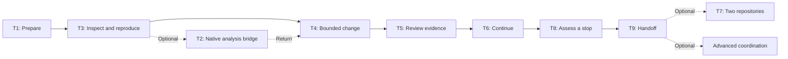

# Tutorials: learn the research workflow by doing

These tutorials are for a physicist or researcher who is comfortable reading technical material and wants to turn a question into work that another person can inspect and challenge. Basic Git familiarity helps with the local exercises; no oral history of TOP-26-006 is needed. You can read the lessons in a browser. Local execution needs the checkout, prepared tools, and permissions specified by the lesson.

This is a learning route through small exercises, with starting points, checkpoints, and something concrete to finish with. Begin with serial work and one repository where sufficient, then add complexity only for a reason. For procedures to use on a task you already understand, return to the [manual's task routes](../index.md#find-the-route-you-need).

## What you will learn

By completing the ordinary curriculum, you should be able to:

1. Prepare and identify a local coordination workspace when execution is needed.
2. Reproduce and challenge one bounded synthetic result, keeping its assumptions and evidence explicit.
3. Make one bounded change in a safe teaching context.
4. Separate execution, observed evidence, review, and human acceptance.
5. Continue from still-valid prior evidence without replaying closed work.
6. Assess a stopped or uncertain task while preserving its evidence and local changes.
7. Prepare a durable collaborator handoff that identifies what remains unresolved.
8. Recognize when a native analysis repository, a second repository, or advanced coordination is actually needed.

These are learning targets, not a qualification of a scientific method or permission to act in a research repository. Native repositories retain authority over their scientific and technical behavior; the responsible humans decide authorization and acceptance.

## Recommended ordinary path

Follow **Tutorial 1 → Tutorial 3 → Tutorial 4 → Tutorial 5 → Tutorial 6 → Tutorial 8 → Tutorial 9**. The lesson links and starting conditions are in the walkthrough table below.

First prepare a workspace, then inspect and reproduce a small synthetic result. Next practise a bounded change, review the evidence for a human decision, and prepare a continuation that preserves valid prior work. Finish by assessing a documented stop and preparing a collaborator handoff. This order teaches the everyday lifecycle before introducing dependencies across repositories or parallel work.

The order is pedagogical. It does not imply that one lesson produced the live state used by the next. Tutorial 4 prepares its own scratch history; the later documentary exercises use stated stages of a maintained scenario and do not require that scratch history. Read each lesson's prerequisites and restart instructions. Learning order transfers no permissions, scientific authority, shell variables, repository state, execution evidence, or acceptance between lessons.

The diagram repeats the ordinary order above. Dotted branches are optional:
Tutorial 2 connects to native analysis, Tutorial 7 crosses repository boundaries,
and Advanced adds coordination only when needed. These are learning choices,
not transfers of permission or evidence. The governance workflow compiler is an
optional authoring tool within a
bounded task, not a new prerequisite or numbered lesson. Use the
[compiler/manual authoring bridge](../how_to/compile_governance_workflow.md#choose-the-authoring-route)
after defining behavior and authority; the ordinary research curriculum remains
the starting point.

## Optional bridges

**Tutorial 2 connects the method to a native analysis repository.** It requires a separately available TOPEFT checkout, so it is not a prerequisite for Tutorial 3's synthetic task. For a newcomer who wants this bridge, the recommended placement is **Tutorial 1 → Tutorial 3 → Tutorial 2**: complete one bounded evidence loop before tracing a real analysis source chain. Then return to the ordinary path at Tutorial 4. If you already have TOPEFT and specifically want the native bridge first, you may enter Tutorial 2 after Tutorial 1. The lesson produces a dated source-reading note, not an executed or qualified analysis.

**Tutorial 7 concerns evidence crossing repository boundaries.** Take it after the ordinary lifecycle when that dependency is your learning objective. Adding a second repository is not a measure of progress through the ordinary lessons. Its optional documentary practice has its own maintained inputs and does not require executing earlier lessons.

**Advanced coordination is a separate choice.** Enter through the [advanced gateway](../advanced/index.md#decide-whether-to-enter-this-route) when separable questions or a specified checking method justify the coordination. Parallel work is optional, not an achievement level. The two advanced tutorials are sequential paper exercises; following them starts no workers or scientific calculation.

## Complete curriculum

If you explicitly want to study every tutorial, use this pedagogical order. The stable tutorial numbers and filenames are retained for existing links; they do not encode mandatory reading order. The optional lessons still bring their own prerequisites and limits.

1. [Tutorial 1 — prepare a research project](01_prepare_a_research_project.md)
2. [Tutorial 3 — complete a first read-only task](03_complete_a_first_read_only_task.md)
3. [Tutorial 2 — connect an analysis repository](02_add_an_analysis_repository.md)
4. [Tutorial 4 — make a bounded analysis change](04_make_a_bounded_analysis_change.md)
5. [Tutorial 5 — review and accept returned evidence](05_review_and_accept_returned_evidence.md)
6. [Tutorial 6 — continue from existing evidence](06_continue_from_existing_evidence.md)
7. [Tutorial 8 — recover from a stopped task](08_recover_from_a_stopped_task.md)
8. [Tutorial 9 — transfer work to a collaborator](09_transfer_work_to_a_collaborator.md)
9. [Tutorial 7 — coordinate a sequential two-repository change](07_coordinate_a_multi_repository_change.md)
10. [Advanced — coordinate parallel research workstreams](advanced/01_coordinate_parallel_research_workstreams.md)
11. [Advanced — reconcile a shared dependency change](advanced/02_reconcile_a_shared_dependency_change.md)

## Walk through the lessons

Use this table to choose an entry point and understand the evidence each lesson can produce. A finish condition describes the exercise's output; it does not establish human acceptance or completion of a later operational task. Where a lesson provides a direct entry or restart procedure, use it without recreating earlier exercises.

| Lesson | Learning target | Start when | You finish with | Place in the path |
| --- | --- | --- | --- | --- |
| [Tutorial 1: prepare a research project](01_prepare_a_research_project.md) | Identify the coordination checkout and a local execution route. | You have repository access and an already-prepared Python interpreter; the lesson checks PyYAML and sets local installation facts. | Git-root observations and a resolved local profile, with limits on what resolution proves. | First ordinary lesson; setup for local execution. |
| [Tutorial 3: complete a first read-only task](03_complete_a_first_read_only_task.md) | Reproduce and challenge the five-measurement summary. | You have a local checkout and prepared Python environment, with a wrapper/interpreter for terminal commands or a matching Jupyter kernel; no TOPEFT checkout is needed. | A note naming input, version, route, observed values, assumptions, discrepancies, and limits. | First bounded evidence loop after setup. |
| [Tutorial 2: connect an analysis repository](02_add_an_analysis_repository.md) | Trace a native analysis request from documentation to source without running it. | You have a separate TOPEFT checkout and Tutorial 1's prepared tools/profile. | A dated, source-bound observation with branch/commit and missing execution evidence identified. | Optional native bridge, preferably after Tutorial 3; then continue at Tutorial 4. |
| [Tutorial 4: make a bounded analysis change](04_make_a_bounded_analysis_change.md) | Make one controlled synthetic interpretation-note change. | You have a coordination checkout, shell, Git, and permission for a new private practice directory/history; no prior run is needed. | One local note commit, parent, patch, and source identities, pending review. | Ordinary change lesson; uses its own scratch seed and a recorded result. |
| [Tutorial 5: review and accept returned evidence](05_review_and_accept_returned_evidence.md) | Distinguish completion, evidence, interpretation, and acceptance. | You can read the maintained scenario and keep personal notes; Tutorial 4's history is unnecessary. | A source-bound review of the reported provenance finding and repair, with limits and real acceptance still pending. | Ordinary review lesson; uses fixed documentary evidence, with a [worked compiler reader example](05_review_and_accept_returned_evidence.md#a-worked-example-from-compiled-prompt-to-returned-evidence). |
| [Tutorial 6: continue from existing evidence](06_continue_from_existing_evidence.md) | Specify the new work while retaining valid prior evidence. | You can read the scenario and prepare a personal draft; no prior execution is required. | A continuation draft naming prior closure, proposed delta, invalidation boundary, protected checks, unknowns, and next action. | Ordinary continuation lesson; starts at the scenario's repaired, pre-stop stage. |
| [Tutorial 8: recover from a stopped task](08_recover_from_a_stopped_task.md) | Assess uncertainty without replay or destructive cleanup. | You can read the fixed intentional-stop record and keep notes; do not recreate the stop. | A personal recovery assessment with preserved closure, unknowns, safe readback, and the next bounded decision. | Next ordinary learning exercise; operational recovery is needed only for an actually stopped task. |
| [Tutorial 9: transfer work to a collaborator](09_transfer_work_to_a_collaborator.md) | Carry durable evidence and unresolved context to a successor. | You need to understand a handoff; optional practice needs only the scenario, template, and personal notes. | A handoff account or practice draft with prior evidence, last observations, unknowns, and the next human decision; recipient comprehension remains pending. | Closes the ordinary route; practice has its own entry at the documented stop. |
| [Tutorial 7: coordinate a sequential two-repository change](07_coordinate_a_multi_repository_change.md) | Keep evidence transfer separate from receiving-side checks and authority. | A genuine cross-repository dependency is the learning objective; optional practice needs only the scenario/template and personal notes. | An explained provider/consumer boundary, or a documentary transfer draft with receiving-side checks and decisions unresolved. | Optional extension after the ordinary lifecycle. |
| [Advanced: coordinate parallel research workstreams](advanced/01_coordinate_parallel_research_workstreams.md) | Decide whether work can usefully overlap and map its dependencies. | You understand the serial lifecycle and have read the advanced gateway and synthetic case. | A dependency sketch and explanation of readiness, checking independence, and claim limits. | Optional paper exercise after the serial route. |
| [Advanced: reconcile a shared dependency change](advanced/02_reconcile_a_shared_dependency_change.md) | Trace affected evidence while preserving valid checks. | You have followed the first advanced exercise and can read the same dependency map/history. | A before/after account of stale and retained evidence, review/acceptance gates, and responsibility transfer. | Second advanced paper exercise in the complete curriculum. |

## Use, restart, and leave the curriculum

Read a lesson's goal and prerequisites before starting. Identify its inputs, what you may change, and what its checkpoint actually tests. If your observation contradicts the checkpoint, preserve the discrepancy and stop the dependent step rather than force the expected result.

After interruption, use the lesson's restart instructions to reopen the saved notes and compare its named inputs. Resume at the first unresolved step; do not blindly repeat setup, overwrite a practice directory, or replay an already recorded result. The documentary lessons let you enter at their specified scenario stage without possessing its historical Git objects or earlier shell state.

Return here after a lesson to choose the next one. Once you know the method, use the [manual's task-oriented routes](../index.md#continue-after-the-first-task) for a concrete need, or its [maintainer gateway](../index.md#maintain-or-author-top26006_fw-tasks) for project configuration and task authoring. Broader coordination begins with the [advanced route's decision criterion](../advanced/index.md#decide-whether-to-enter-this-route), not simply with finishing more tutorials.
